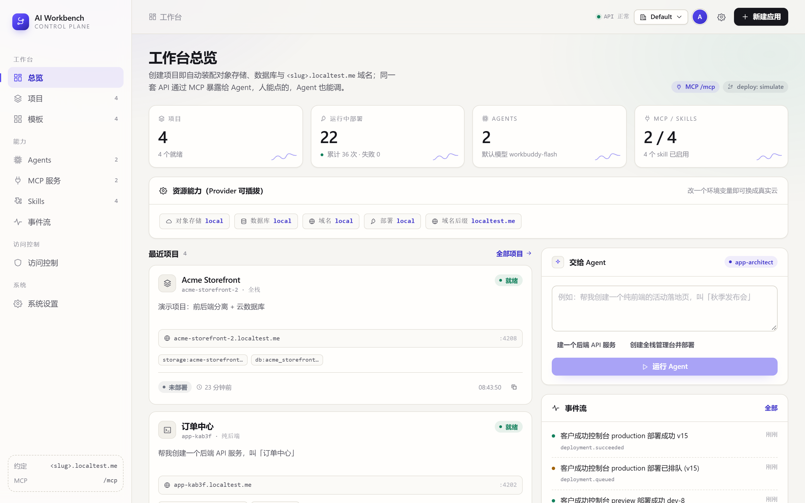
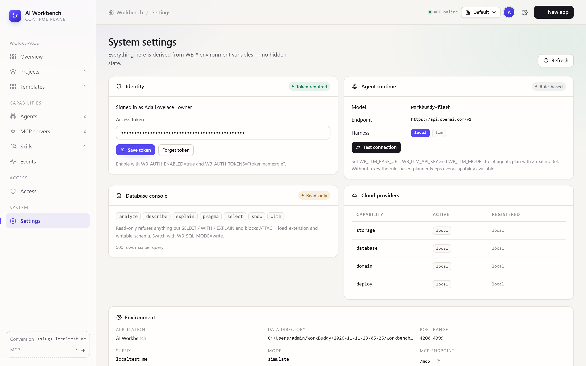
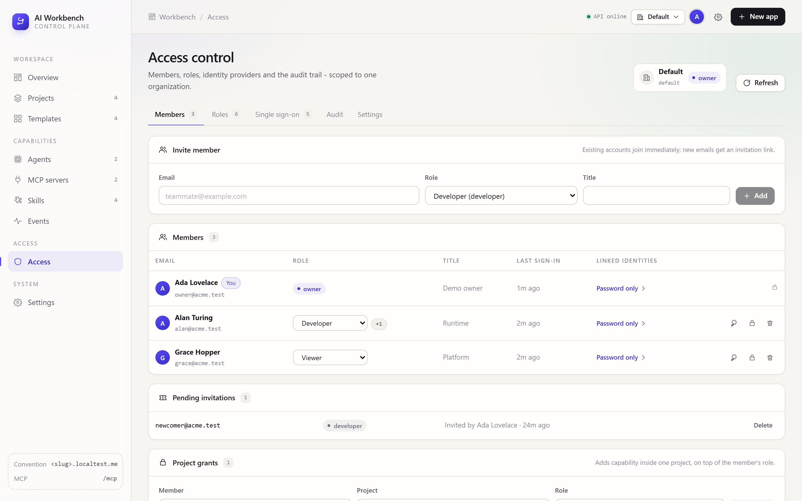
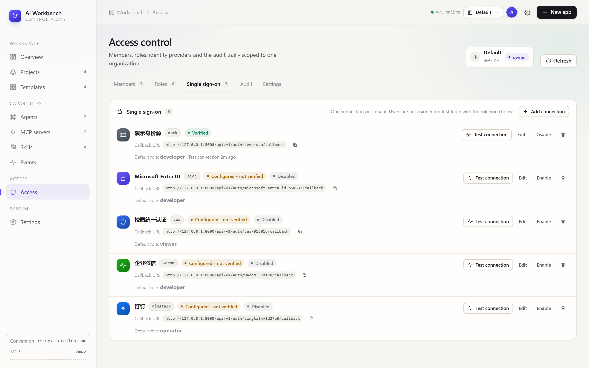

# AI Workbench

**A visual control plane for applications that AI agents can build, modify and deploy on their own.**

[中文](README.zh-CN.md) · [Architecture](docs/architecture.md) · MIT


---

## Why this exists

Most "AI builds your app" demos stop at code generation. The hard part starts
after: the app needs a bucket, a database, a domain, environment variables, a
deploy target — and the agent needs a *stable programmatic surface* to touch all
of that later without a human clicking around.

AI Workbench is that surface. You create a project visually, the platform
conventionally provisions everything it needs, and the exact same operations are
exposed over MCP so an agent can keep working on it afterwards. **There is no
"UI capability" that an agent can't reach.**

---

## What you get

| | |
| --- | --- |
| **Visual project creation** | Pick a template, get storage + database + `<slug>.<suffix>` domain provisioned automatically |
| **Four templates, four shapes** | Fullstack (FastAPI + Next.js), pure frontend (Vite + React), pure backend (FastAPI + MCP), agent service (FastAPI + MCP + harness) |
| **In-project code editing** | File tree + syntax-highlighting editor with zero extra dependencies — the same `write_project_file` call an agent makes |
| **A real debug environment** | Every project gets `<slug>-dev.<suffix>` on its own port and process, hot reload included. The panel embeds the live site |
| **Version control in the UI** | Stage, diff, commit, restore a file, revert a commit — git is the source of truth, not a side feature |
| **Publish = commit → tag → deploy** | Publish tags `deploy/v<N>` and deploys *that* sha, so "what is live" is a git object you can point at |
| **One-click deploy** | Versioned deployments with streaming build logs and health checks |
| **Live resources** | SQL console against the project's own database, object browser for its bucket |
| **MCP / Skills / Agents** | All three are first-class, visually managed entities stored as data |
| **A real agent, or a fake one** | Pluggable harness: point `WB_LLM_BASE_URL` at any OpenAI-compatible endpoint and the agent plans over tool calls; without a key it falls back to a deterministic rule planner |
| **Guarded database console** | Read-only by default: statement allow-list plus a deny-list for `ATTACH`, `load_extension`, `writable_schema` |
| **Organizations + real RBAC** | Five built-in roles over a 35-key permission catalog, custom roles, project-scoped grants, invitations, suspension, audit trail — one route table guards REST *and* `/mcp` |
| **SSO: CAS / OAuth2 / OIDC / WeCom / DingTalk** | Each provider is data, configured in the UI, verified by a real probe; JIT provisioning and IdP-group → role mapping on first login |
| **Conventions over configuration** | Three type specs (fullstack / frontend / backend) drive scaffolding, a conformance report, the preview command and the agent prompt from one place |
| **Swappable cloud** | Storage / database / DNS / deploy sit behind one Provider SPI — swapping a cloud is one env var |
| **Bilingual, themeable, relocatable UI** | English/Chinese (defaults to English), system/light/dark theme, and the nav can live in a sidebar or the top bar |

---

## Quick start

Requirements: Python ≥ 3.11, [uv](https://docs.astral.sh/uv/), Node.js ≥ 20, git on
`PATH` (publish and version control shell out to it).

```bash
git clone <your-repo> ai-workbench && cd ai-workbench

# 1 — backend (REST + MCP on :8000)
cd backend
uv sync
uv run uvicorn app.main:app --reload --port 8000

# 2 — frontend (:3000), in another terminal
cd frontend
npm install
npm run dev
```

Open <http://localhost:3000>. Two demo projects are seeded on first boot
(`WB_BOOTSTRAP_DEMO_DATA=true`).

No cloud credentials are needed. `localtest.me` resolves `*.localtest.me` to
`127.0.0.1`, so `customer-success.localtest.me` works in your browser with zero
DNS setup.

Auth is off by default — the console just opens, which is what you want on a
laptop. To see organizations, roles and SSO for real, turn it on and seed a demo
tenant (the seeder only uses the public API, so a real tenant could be built the
same way):

```bash
cd backend
WB_AUTH_ENABLED=true uv run uvicorn app.main:app --port 8000   # terminal 1

uv run python tools/access_demo.py                             # terminal 2
# → owner@acme.test / workbench-demo-1, then open /access
```

**Generated projects land in `data/projects/<slug>/`.** Delete `data/` to reset
the whole platform.

---

## Walkthrough

### Create a project

Template → name → optional subdomain prefix. The checkbox at the bottom triggers
the first deployment immediately.


### A project has eight tabs

| Tab | What it does |
| --- | --- |
| 概览 / Overview | Runtime, provisioned cloud resources, domain bindings, env vars, recent deploys |
| 代码 / Code | File tree + editor; create, save, delete, revert a single file |
| 调试 / Debug | Live preview on `<slug>-dev.<suffix>`, start / stop / restart, streaming log, publish |
| 版本 / Version | Working-tree status, diffs, commit history, commit, revert |
| 部署 / Deploy | Deployment history, live build log, stop / redeploy |
| 数据 / Data | SQL console against the project database, object storage browser |
| 规范 / Conventions | The type spec, a pass/warn/fail report, the resolved commands and the override file |
| 设置 / Settings | Env vars, custom domains, destructive delete |


### Editing code

The editor is a transparent `<textarea>` layered over a highlighted `<pre>` with
identical font metrics — no Monaco, no CodeMirror, no dependency. Highlighting is
a sticky-regex tokenizer per language, scroll-synced with the line gutter, with
`Ctrl/⌘+S` to save, `Tab`/`Shift+Tab` to indent and auto-indent on `Enter`.

It writes through the very same `write_project_file` tool an agent calls, so
there is no privileged editing path.


### Debugging: `<slug>-dev`

The debug environment is not a mode of the deployment — it is its own environment,
with its own port, its own process and its own domain, so a preview restart can
never take production down.

```
production  http://customer-success.localtest.me:4200
preview     http://customer-success-dev.localtest.me:4204   ← WB_PREVIEW_SUFFIX=-dev
```

It degrades in exactly one direction, and says which one it took:

1. **dev server** — the resolved `dev_command` really runs (hot reload).
2. **static host** — no `node_modules`/`.venv` yet, so serve `dist/` → `build/` →
   `out/` → compiled `index.html`.
3. **explainer page** — nothing buildable at all, so render the file tree, the
   README and the exact command to run instead of handing you a dead port.

The mode is recorded on the deployment row and shown as a tag (`static:explainer`
above), so a screenshot never lies about what answered.


### Version control and publishing

Git is not bolted on: the workspace is a repo from creation, and every publish is
`commit → tag deploy/v<N> → deploy that commit_sha`, recorded on the deployment
row. Rolling back is therefore an ordinary revert, not a guess about which folder
is live.


### Conventions, checked

The type spec is executable data, not prose. One `TypeSpec` per project type feeds
template rendering, the conformance report, the preview command and the agent's
system prompt — so the docs, the UI and the agent cannot drift apart.


Read the specs: **[docs/conventions/](docs/conventions/README.md)** —
[fullstack](docs/conventions/fullstack.md) ·
[frontend](docs/conventions/frontend.md) ·
[backend](docs/conventions/backend.md).

### Deploying

Deployments are async: the request returns immediately, the log streams as the
build progresses, and a health check decides `running` vs `failed`. The browser
consumes the log over **SSE** (`/deployments/{id}/stream`), so there is no polling
interval to tune — and a second deploy on the same project is refused with `409`
while one is in flight.


The data tab talks to the project's own database through the same provider
interface a real cloud would implement. The console is **read-only by default** —
`DROP`, `ATTACH` and `PRAGMA writable_schema` are rejected before they reach
SQLite.


### Managing the capability layer

MCP servers, Skills and Agents are stored as rows, tied together by id — so an
agent's capabilities can be recomposed from the UI at any time without touching
code.


Every mutation lands in a global event stream, which is also what the dashboard
counter is built from.


### Preferences

One popover controls language, theme and nav placement. All three persist to
localStorage and are applied before hydration, so there's no flash of the wrong
theme.


Choosing **Top bar** moves the whole nav into the header and reclaims the
sidebar width for content — useful on wide monitors.


The same UI in Chinese:



---

## Internationalisation

The frontend ships two locales. `lib/i18n.tsx` holds a flat, **type-derived**
dictionary: `MessageKey` is generated from the English object, so a mistyped key
is a compile error and a missing Chinese entry is a compile error too. Date and
relative-time formatting follow the active locale, and status badges store
message keys instead of hard-coded labels.

```tsx
const { t, locale } = useI18n();
t("dash.kpi.projectsFoot", { ready: 3 });   // "3 ready" / "3 个就绪"
relativeTime(project.updated_at, locale);   // "2h ago" / "2 小时前"
```

Adding a locale means adding one object and one entry to `LOCALES`.

---

## The MCP surface

The workbench mounts its own MCP server **on the same port** as the REST API
(`/mcp`, streamable HTTP). Tools are the same Python callables the REST layer
uses — no parallel implementation to drift.

```json
{ "mcpServers": { "workbench": { "url": "http://127.0.0.1:8000/mcp" } } }
```

| Tool | Purpose |
| --- | --- |
| `describe_workbench` | Conventions, providers, template keys, harness and tool list — call this first |
| `list_templates` | Available templates and the resources each one provisions |
| `create_project` | Scaffold + provision storage, database, domain (production *and* preview) |
| `list_projects` / `get_project` | Inspect state, resources, domains, latest deployment |
| `list_project_files` / `read_project_file` / `write_project_file` / `delete_project_file` | Read and modify application code |
| `search_project` | Grep the workspace; returns path, line number and the matching line |
| `check_project_conventions` | Grade the workspace against its type spec — run this before editing or publishing |
| `start_preview` / `stop_preview` / `preview_status` | Drive the debug environment on `<slug>-dev` |
| `run_project` | Run production from the current working tree |
| `publish_project` | commit → tag `deploy/v<N>` → deploy that commit |
| `deploy_project` / `deployment_status` | Trigger a plain deploy, then poll it |
| `git_status` / `git_log` / `git_diff` | Inspect the working tree, history and diffs |
| `git_commit` / `git_restore_file` / `git_revert_commit` | Commit, discard a file's changes, roll back by revert |
| `list_env_vars` / `set_env_var` | Inspect and change environment, injected on next deploy |
| `query_database` | Run a guarded read-only query against the project's database |
| `add_domain` | Bind an extra domain to a project |
| `list_agents` | See configured agents with their MCP servers and skills |

Typical agent loop — the same five verbs a human clicks:

```
describe_workbench → check_project_conventions → write_project_file
                   → start_preview → publish_project
```

REST equivalent: 55 endpoint paths under `/api/v1`, browsable at
<http://localhost:8000/docs>.

---

## Three project types

`backend/app/services/conventions.py` holds one `TypeSpec` per type. It is the only
place that knows what "a fullstack project" means, and everything else reads it.

| Type | Layout | Dev command | Health |
| --- | --- | --- | --- |
| `fullstack` | `backend/` + `frontend/` | `npm --prefix frontend run dev -- --port {dev_port}` | `/health` |
| `frontend` | single Vite app | `npm run dev -- --port {dev_port}` | `/` |
| `backend` | FastAPI only | `python -m uvicorn app.main:app --host 0.0.0.0 --port {port} --reload` | `/health` |

The spec is enforced in five places from that one definition: scaffolding, the
**Conventions** tab (`GET /projects/{id}/conventions`), the `check_project_conventions`
agent tool, the preview command resolver, and the publish gate.

When a workspace genuinely needs to differ, there is exactly **one** sanctioned
override file at the project root — everything else is convention:

```yaml
# workbench.yaml
type: fullstack
dev_command: npm --prefix frontend run dev -- --port {port}
health_path: /healthz
preview_suffix: -sigma
```

---

## Agent runtime

Two harnesses ship, and the runtime picks one from config:

| Harness | When | What it does |
| --- | --- | --- |
| `llm` | `WB_LLM_API_KEY` is set (or `WB_AGENT_HARNESS=llm`) | Real function-calling loop against any OpenAI-compatible `/chat/completions` endpoint |
| `local` | Otherwise | Deterministic keyword router — every capability still works, comprehension is shallow |

Tool schemas are **generated from the Python signatures and docstrings** the REST
layer already uses, so an agent capability and an API endpoint are the same
object. If the model endpoint is unreachable mid-run the runtime records the
failure as a step, falls back to the local planner, and flags the run — you get
an answer instead of a red toast.

```bash
# OpenAI / Azure / vLLM / Ollama / DashScope-compatible — all the same client
WB_LLM_BASE_URL=https://api.openai.com/v1
WB_LLM_API_KEY=sk-...
WB_LLM_MODEL=gpt-4o-mini
```

`backend/tools/mock_llm.py` is a fake endpoint that replays a canned tool call,
so the whole loop is testable offline:

```bash
python tools/mock_llm.py                       # :8811
WB_LLM_BASE_URL=http://127.0.0.1:8811/v1 WB_LLM_API_KEY=test uv run uvicorn app.main:app
```

Settings → **Test connection** does one round-trip and shows the model's reply.



---

## Access control

Off by default (a local workbench shouldn't ask for credentials to open a page).
Turn it on and every request — REST *and* the mounted MCP app — is authorized
against the same permission catalog:

```bash
WB_AUTH_ENABLED=true
WB_AUTH_ALLOW_SIGNUP=true          # first user of a new org becomes its owner
```

**Organizations are the tenancy boundary.** A user belongs to an org through a
membership that carries exactly one role; the session is pinned to one org at a
time and the top-right menu switches between them. Nothing crosses that line —
an admin of org A editing a path segment to reach org B gets a `404`, so the
existence of B isn't even confirmed.

**A role is a named set of permissions from a 35-key catalog** (`project:deploy`,
`sso:manage`, `member:invite`, …). Five ship with every org — `owner` `admin`
`developer` `operator` `viewer` — and you can add your own in the UI with a
checkbox grid. There is no inheritance to reason about; the effective permission
set is just the union of your org role and any project-scoped grants.

| Layer | What it decides |
| --- | --- |
| Middleware | Maps the method + path to a permission through a route table, so `/mcp` inherits the REST policy instead of drifting from it. Unmatched writes fail closed |
| Handler | Re-checks the org in the URL against the principal, then the permission. Denials are audited *before* the 403 leaves |

Sessions are opaque bearer tokens (`wbs_…`, SHA-256 at rest, 12 h sliding),
passwords are scrypt via the stdlib. Everything below is one page —
`/access` — with members, roles, SSO, audit and settings tabs, each hidden when
you lack the permission for it:



Roles are edited inline, built-ins included (except `owner`, which must stay
total so an org can never lock itself out):


### Single sign-on

Five provider families, all pluggable and all configured as data, so adding one
is a row in the database rather than a release:

| Kind | Flow | Notes |
| --- | --- | --- |
| **OIDC** | discovery → `id_token` verified against JWKS | PKCE S256, `iss`/`aud`/`nonce` checked, `alg=none` rejected |
| **OAuth2** | authorize → token → userinfo | maps configurable claims onto name/email/groups |
| **CAS** | `serviceValidate` (or `p3/`) XML | state rides inside the `service` URL; proxy tickets rejected |
| **WeCom** | QR login or in-client OAuth | two different hosts for the two cases — picked automatically |
| **DingTalk** | `oauth2/userAccessToken` → `contact/users/me` | subject is the `unionId`, so moving apps keeps identity |

Every connection has a callback URL you copy from the UI, a **Test connection**
button that performs a real round-trip (saved-but-unverified is `unchecked`,
never `ready`), an IdP-group → role map, and JIT provisioning so an SSO user
exists the moment they first log in:



The workbench also serves an OIDC-shaped mock IdP at
`/api/v1/auth/mock/authorize`, which walks the *real* state → code → token →
profile path — so the whole flow is testable offline and in CI:


Full manual — catalog, route table, per-provider field reference, bootstrap
runbook for an SSO-only install: [docs/access.md](docs/access.md).

---

## Conventions

Everything derives from the project slug — the "configuration" is just the name
you gave it.

| Thing | Rule |
| --- | --- |
| Workspace | `data/projects/<slug>` |
| Bucket | `<slug>-assets` |
| Database | `<slug>` |
| Primary domain | `<slug>.<WB_DOMAIN_SUFFIX>` |
| Preview domain | `<slug><WB_PREVIEW_SUFFIX>.<WB_DOMAIN_SUFFIX>` — `-dev` by default |
| Ports | two, from the first free in `4200–4399` (production + preview) |
| Commands | from the type spec, overridable in `workbench.yaml` |
| Publish | `git tag deploy/v<N>` on the deployed commit |

Full rationale and per-type details: [docs/conventions/](docs/conventions/README.md).

---

## Making it yours

| Goal | Where | Frontend changes |
| --- | --- | --- |
| Different cloud (COS / S3 / Postgres / DNSPod / Docker) | Add a provider module, set `WB_*_PROVIDER` | none |
| New template | One dataclass in `backend/app/services/templates.py` | none |
| New agent capability | One function + entry in `TOOLS` — REST, MCP and the agent all get it | none |
| New project type | One `TypeSpec` + a template in `conventions.py` / `templates.py` | none |
| Swap the agent framework (agentscope, langgraph) | Subclass `Harness`, call `register_harness` | none |
| Different model provider | Set `WB_LLM_BASE_URL` / `WB_LLM_MODEL` | none |
| Loosen the SQL console | `WB_SQL_MODE=write` | none |
| Add a role | The role editor in `/access` — it's a row, not a release | none |
| Add an SSO provider kind | One `IdP` subclass + a `SCHEMA` dict — the UI form renders itself | none |
| Add a permission | One line in `core/permissions.py` — API, role editor, route table and agent prompt all follow | none |
| Embed real VS Code | Set `WB_IDE_URL_TEMPLATE` | none |
| New locale | One object in `lib/i18n.tsx` | none |
| New resource kind (e.g. Redis) | New provider capability + template declaration | yes |

The rule of thumb: anything inside the **Provider / Template / Tool** triangle
needs no frontend work. Only adding a *new kind of entity* does.

Providers are registered by decorator and resolved by name at runtime:

```python
@register_provider("storage", "s3")
class S3Storage(StorageProvider):
    def create_bucket(self, bucket, *, project_id): ...
```

`GET /api/v1/system/providers` lists whatever is registered.

---

## Configuration

Copy `.env.example` to `.env`. Every key is optional and prefixed `WB_`.

```bash
WB_DOMAIN_SUFFIX=localtest.me    # *.localtest.me -> 127.0.0.1
WB_PREVIEW_SUFFIX=-dev           # -> <slug>-dev.localtest.me
WB_PREVIEW_MODE=auto             # auto | process | static
WB_PREVIEW_TIMEOUT=25            # seconds before falling back to the static host
WB_DEPLOY_MODE=simulate          # simulate | process
WB_STORAGE_PROVIDER=local        # swap for s3 / cos / oss ...
WB_IDE_URL_TEMPLATE=             # optional code-server entry, {path} {project}
WB_DATA_DIR=./data               # projects, buckets, databases, dns

WB_AGENT_HARNESS=auto            # auto | local | llm
WB_LLM_BASE_URL=https://api.openai.com/v1
WB_LLM_API_KEY=                  # set -> agents plan with a real model
WB_LLM_MODEL=

WB_SQL_MODE=readonly             # readonly | write
WB_AUTH_ENABLED=false            # true -> sign in required, REST + /mcp
WB_AUTH_ALLOW_SIGNUP=true        # false -> only invitations and SSO
WB_AUTH_SESSION_HOURS=12         # sliding session lifetime
WB_AUTH_DEFAULT_ORG=default      # org a brand-new account lands in
WB_PUBLIC_API_BASE=              # how the browser reaches the API (SSO callbacks)
WB_FRONTEND_URL=http://localhost:3000
```

`WB_DEPLOY_MODE=process` actually spawns the project's run command on its
allocated port; `simulate` (default) produces a realistic build log without
starting anything. Preview follows `WB_DEPLOY_MODE` unless `WB_PREVIEW_MODE` says
otherwise — and it always falls back to the static host rather than leaving a dead
port in the iframe.

Schema changes are applied forward-only on boot (`app/core/migrate.py`): additive
columns, idempotent indexes. No migration step to remember, no `ALTER` surprises.

---

## Project layout

```
backend/
  app/
    api/           auth · orgs · projects · workspace · platform · registry · system
    core/          config · db · security · permissions · passwords · context
                   migrate · errors · ids
    services/      conventions · scaffold · templates · deployments · gitops
                   identity · audit · system_tools · agent_runtime · llm · sql_guard
    providers/     base (SPI + registry) + local/{storage,database,domain,deploy,static_host}
                   auth/{base,cas,oauth2(OIDC),wecom,dingtalk}
    mcp/server.py  fastmcp server, mounted on the same port
    models.py      21 tables
  tools/           mock_llm.py · auth_smoke.py · access_demo.py
frontend/
  app/             13 routes, eight tabs under /projects/[id]
  components/      Shell · Rail · Topbar · NavLinks · Preferences · SessionMenu
                   AuthGate · CreateProjectDialog · LogViewer · CodeEditor
                   access/{Members,Roles,Sso,Audit,Settings}Panel · Icon (all SVG)
  lib/             api · session · auth · access · types · format · i18n · prefs · nav
docs/architecture.md   design rationale, data model, extension points
docs/access.md         RBAC, organizations, SSO — the operator's manual
docs/conventions/      the three type specs + "convention over configuration"
scripts/shoot.mjs      smoke walk-through that produces the screenshots above
```

---

## Known limitations

The preview host runs **in the control-plane process**, so restarting the backend
drops live previews — the state endpoint detects the dead port and reports
`stopped` rather than lying, but it does not respawn them · the built-in editor has
no multi-file search-and-replace · role grants are per-org and per-project, but
there is no per-*resource* ACL below that · SSO group → role mapping needs the IdP
to actually send a groups claim, and there is no SCIM, so a leaver keeps access
until you suspend them here or their session expires · the SQL guard is a
first-keyword allow-list, not a real parser · deployments are serialised per
process, so two API replicas could still race · MCP auth relies on the client
sending the bearer header · the agent's writes are unshadowed — no dry-run before
`write_project_file`. See
[§14 of the architecture doc](docs/architecture.md#14-已知限制与下一步) for the
recommended fix for each.

---

## License

MIT — see [LICENSE](LICENSE).
