# AI Workbench

**A visual control plane for applications that AI agents can build, modify and deploy on their own.**

[中文](README.zh-CN.md) · [Architecture](docs/architecture.md) · MIT

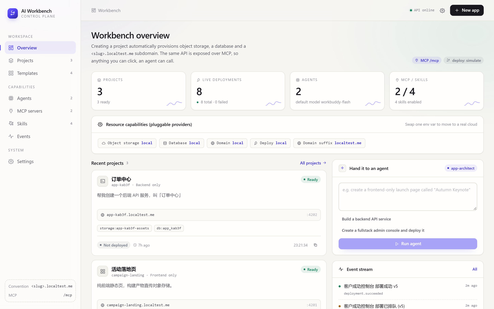

---

## Why this exists

Most "AI builds your app" demos stop at code generation. The hard part starts
after: the app needs a bucket, a database, a domain, environment variables, a
deploy target — and the agent needs a *stable programmatic surface* to touch all
of that later without a human clicking around.

AI Workbench is that surface. You create a project visually, the platform
conventionally provisions everything it needs, and the exact same operations are
exposed over MCP so an agent can keep working on it afterwards. **There is no
"UI capability" that an agent can't reach.**

---

## What you get

| | |
| --- | --- |
| **Visual project creation** | Pick a template, get storage + database + `<slug>.<suffix>` domain provisioned automatically |
| **Four templates, four shapes** | Fullstack (FastAPI + Next.js), pure frontend (Vite + React), pure backend (FastAPI + MCP), agent service (FastAPI + MCP + harness) |
| **Online editing** | Built-in file editor out of the box; point `WB_IDE_URL_TEMPLATE` at code-server / openvscode-server to embed real VS Code in an iframe |
| **One-click deploy** | Versioned deployments with streaming build logs and health checks |
| **Live resources** | SQL console against the project's own database, object browser for its bucket |
| **MCP / Skills / Agents** | All three are first-class, visually managed entities stored as data |
| **A real agent, or a fake one** | Pluggable harness: point `WB_LLM_BASE_URL` at any OpenAI-compatible endpoint and the agent plans over tool calls; without a key it falls back to a deterministic rule planner |
| **Guarded database console** | Read-only by default: statement allow-list plus a deny-list for `ATTACH`, `load_extension`, `writable_schema` |
| **Optional token auth** | `viewer` / `editor` / `admin` roles enforced in one middleware, covering REST *and* `/mcp`; off by default for local use |
| **Conventions over configuration** | Workspace path, bucket name, database name, primary domain and port all derive from the slug |
| **Swappable cloud** | Storage / database / DNS / deploy sit behind one Provider SPI — swapping a cloud is one env var |
| **Bilingual, themeable, relocatable UI** | English/Chinese (defaults to English), system/light/dark theme, and the nav can live in a sidebar or the top bar |

---

## Quick start

Requirements: Python ≥ 3.11, [uv](https://docs.astral.sh/uv/), Node.js ≥ 20.

```bash
git clone <your-repo> ai-workbench && cd ai-workbench

# 1 — backend (REST + MCP on :8000)
cd backend
uv sync
uv run uvicorn app.main:app --reload --port 8000

# 2 — frontend (:3000), in another terminal
cd frontend
npm install
npm run dev
```

Open <http://localhost:3000>. Two demo projects are seeded on first boot
(`WB_BOOTSTRAP_DEMO_DATA=true`).

No cloud credentials are needed. `localtest.me` resolves `*.localtest.me` to
`127.0.0.1`, so `customer-success.localtest.me` works in your browser with zero
DNS setup.

**Generated projects land in `data/projects/<slug>/`.** Delete `data/` to reset
the whole platform.

---

## Walkthrough

### Create a project

Template → name → optional subdomain prefix. The checkbox at the bottom triggers
the first deployment immediately.

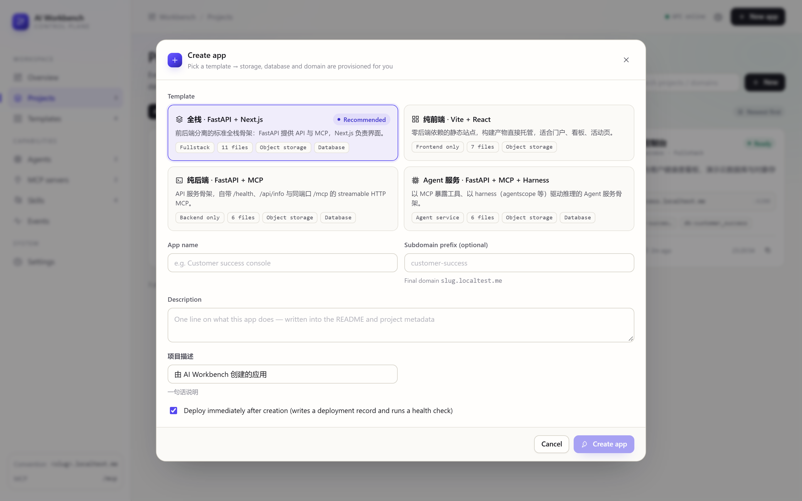

### A project has five tabs

| Tab | What it does |
| --- | --- |
| 概览 / Overview | Runtime, provisioned cloud resources, domain bindings, env vars, recent deploys |
| 代码 / IDE | File tree + editor, or an embedded VS Code if `WB_IDE_URL_TEMPLATE` is set |
| 部署 / Deploy | Deployment history, live build log, stop / redeploy |
| 数据 / Data | SQL console against the project database, object storage browser |
| 设置 / Settings | Env vars, custom domains, destructive delete |

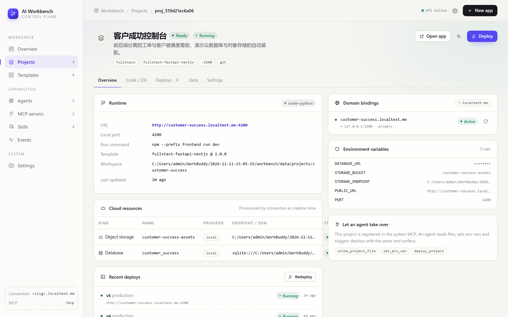

### Editing code

Without an external IDE the built-in editor reads and writes the workspace
directly — the same `write_project_file` call an agent would make.

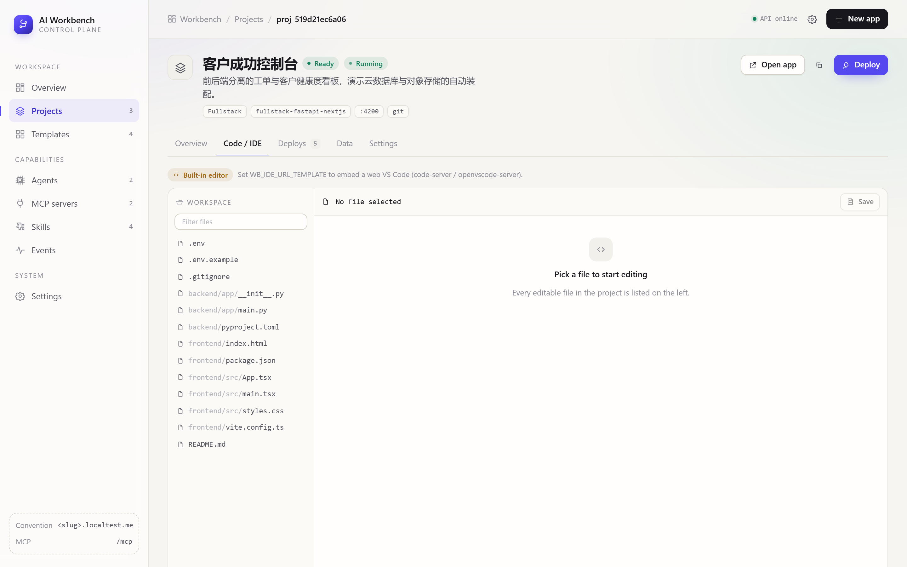

### Deploying

Deployments are async: the request returns immediately, the log streams as the
build progresses, and a health check decides `running` vs `failed`. The browser
consumes the log over **SSE** (`/deployments/{id}/stream`), so there is no polling
interval to tune — and a second deploy on the same project is refused with `409`
while one is in flight.

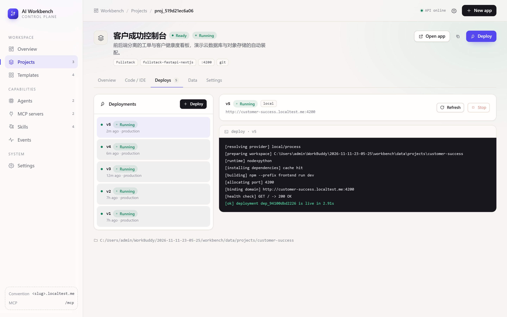

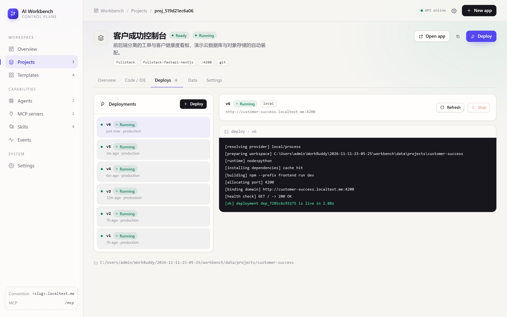

The data tab talks to the project's own database through the same provider
interface a real cloud would implement. The console is **read-only by default** —
`DROP`, `ATTACH` and `PRAGMA writable_schema` are rejected before they reach
SQLite.

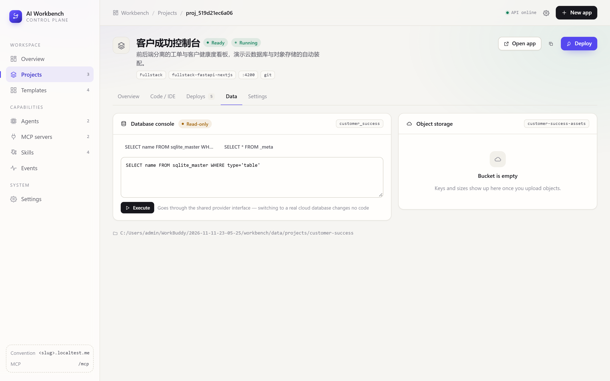

### Managing the capability layer

MCP servers, Skills and Agents are stored as rows, tied together by id — so an
agent's capabilities can be recomposed from the UI at any time without touching
code.

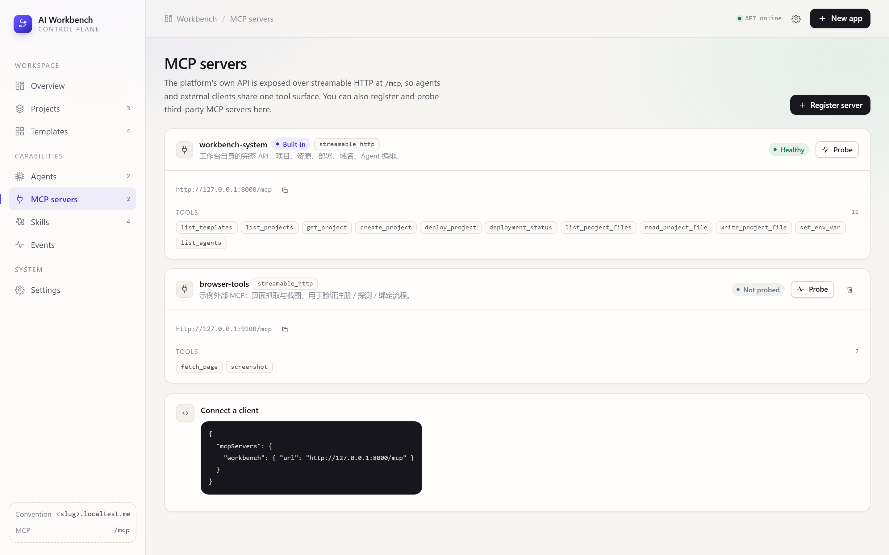

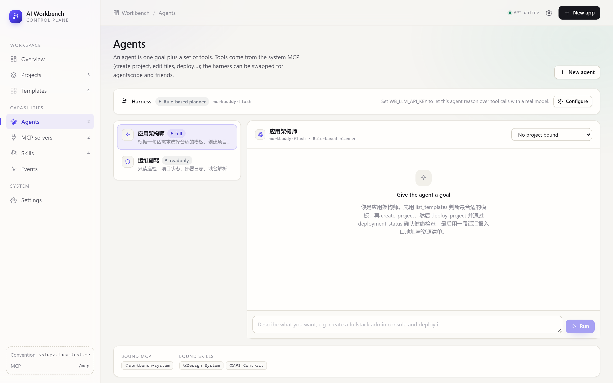

Every mutation lands in a global event stream, which is also what the dashboard
counter is built from.

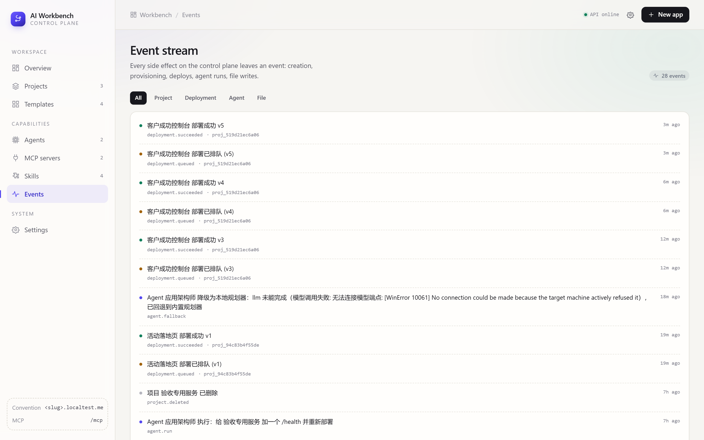

### Preferences

One popover controls language, theme and nav placement. All three persist to
localStorage and are applied before hydration, so there's no flash of the wrong
theme.

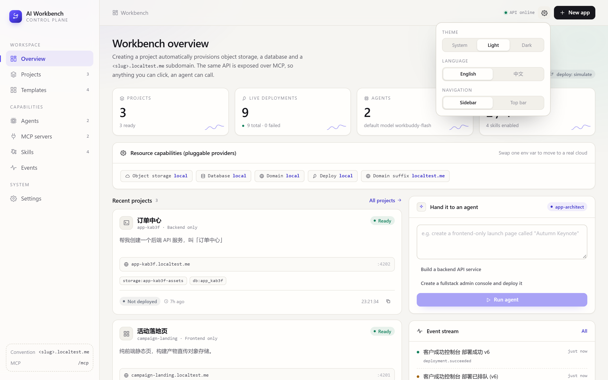

Choosing **Top bar** moves the whole nav into the header and reclaims the
sidebar width for content — useful on wide monitors.

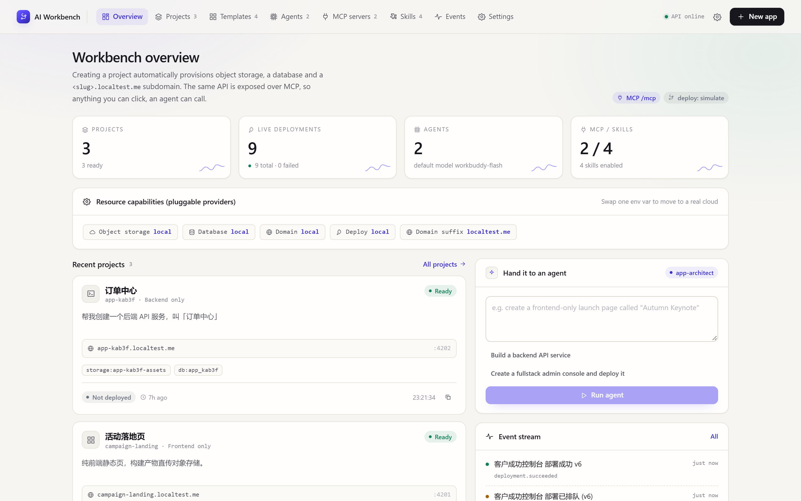

The same UI in Chinese:

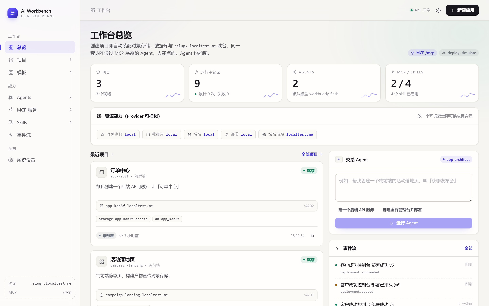

---

## Internationalisation

The frontend ships two locales. `lib/i18n.tsx` holds a flat, **type-derived**
dictionary: `MessageKey` is generated from the English object, so a mistyped key
is a compile error and a missing Chinese entry is a compile error too. Date and
relative-time formatting follow the active locale, and status badges store
message keys instead of hard-coded labels.

```tsx
const { t, locale } = useI18n();
t("dash.kpi.projectsFoot", { ready: 3 });   // "3 ready" / "3 个就绪"
relativeTime(project.updated_at, locale);   // "2h ago" / "2 小时前"
```

Adding a locale means adding one object and one entry to `LOCALES`.

---

## The MCP surface

The workbench mounts its own MCP server **on the same port** as the REST API
(`/mcp`, streamable HTTP). Tools are the same Python callables the REST layer
uses — no parallel implementation to drift.

```json
{ "mcpServers": { "workbench": { "url": "http://127.0.0.1:8000/mcp" } } }
```

| Tool | Purpose |
| --- | --- |
| `describe_workbench` | Conventions, providers, template keys, harness and tool list — call this first |
| `list_templates` | Available templates and the resources each one provisions |
| `create_project` | Scaffold + provision storage, database, domain |
| `list_projects` / `get_project` | Inspect state, resources, domains, latest deployment |
| `list_project_files` / `read_project_file` / `write_project_file` / `delete_project_file` | Read and modify application code |
| `list_env_vars` / `set_env_var` | Inspect and change environment, injected on next deploy |
| `query_database` | Run a guarded read-only query against the project's database |
| `add_domain` | Bind an extra domain to a project |
| `deploy_project` / `deployment_status` | Trigger a build, then poll it |
| `list_agents` / `run_workbench_agent` | Delegate a high-level goal to a configured agent |
| `workbench_capabilities` | Object model + conventions, so an external agent can plan safely |

Typical agent loop:

```
describe_workbench → list_templates → create_project → write_project_file → deploy_project → deployment_status
```

REST equivalent: 40 endpoint paths under `/api/v1`, browsable at
<http://localhost:8000/docs>.

---

## Agent runtime

Two harnesses ship, and the runtime picks one from config:

| Harness | When | What it does |
| --- | --- | --- |
| `llm` | `WB_LLM_API_KEY` is set (or `WB_AGENT_HARNESS=llm`) | Real function-calling loop against any OpenAI-compatible `/chat/completions` endpoint |
| `local` | Otherwise | Deterministic keyword router — every capability still works, comprehension is shallow |

Tool schemas are **generated from the Python signatures and docstrings** the REST
layer already uses, so an agent capability and an API endpoint are the same
object. If the model endpoint is unreachable mid-run the runtime records the
failure as a step, falls back to the local planner, and flags the run — you get
an answer instead of a red toast.

```bash
# OpenAI / Azure / vLLM / Ollama / DashScope-compatible — all the same client
WB_LLM_BASE_URL=https://api.openai.com/v1
WB_LLM_API_KEY=sk-...
WB_LLM_MODEL=gpt-4o-mini
```

`backend/tools/mock_llm.py` is a fake endpoint that replays a canned tool call,
so the whole loop is testable offline:

```bash
python tools/mock_llm.py                       # :8811
WB_LLM_BASE_URL=http://127.0.0.1:8811/v1 WB_LLM_API_KEY=test uv run uvicorn app.main:app
```

Settings → **Test connection** does one round-trip and shows the model's reply.

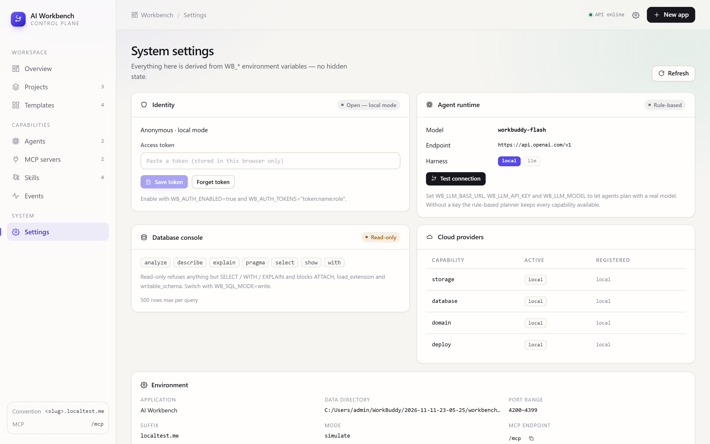

---

## Access control

Off by default (a local workbench shouldn't ask for credentials to open a page).
Turn it on and one middleware guards both REST and the mounted MCP app:

```bash
WB_AUTH_ENABLED=true
WB_AUTH_TOKENS="tok_admin:alice:admin,tok_read:bob:viewer"
```

| Role | Can do |
| --- | --- |
| `viewer` | Read everything they own |
| `editor` | Create/modify, cannot delete |
| `admin` | Everything, sees every project |

Projects carry an `owner_id`; non-admins only see their own. The browser keeps the
token in `localStorage`, attaches it as a bearer header, and any `401` raises one
unlock dialog instead of N broken pages.

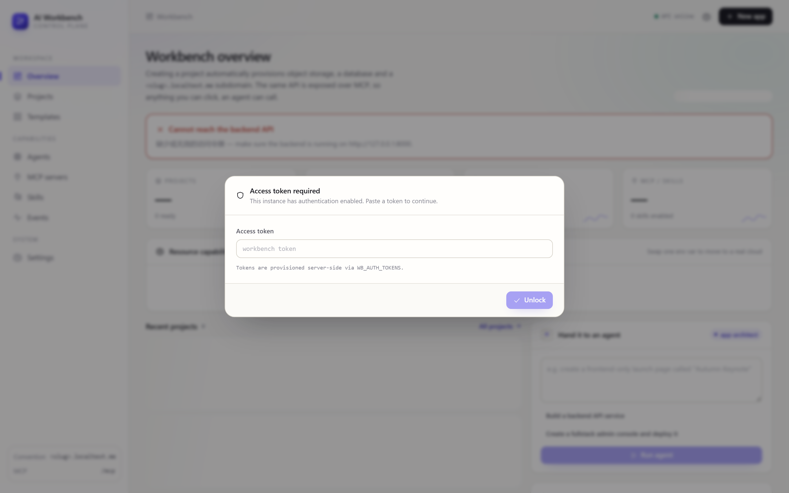

---

## Conventions

Everything derives from the project slug — the "configuration" is just the name
you gave it.

| Thing | Rule |
| --- | --- |
| Workspace | `data/projects/<slug>` |
| Bucket | `<slug>-assets` |
| Database | `<slug>` |
| Primary domain | `<slug>.<WB_DOMAIN_SUFFIX>` |
| Local port | first free in `4200–4399` |
| Run command | from the template, overridable per project |

---

## Making it yours

| Goal | Where | Frontend changes |
| --- | --- | --- |
| Different cloud (COS / S3 / Postgres / DNSPod / Docker) | Add a provider module, set `WB_*_PROVIDER` | none |
| New template | One dataclass in `backend/app/services/templates.py` | none |
| New agent capability | One function + entry in `TOOLS` — REST, MCP and the agent all get it | none |
| Swap the agent framework (agentscope, langgraph) | Subclass `Harness`, call `register_harness` | none |
| Different model provider | Set `WB_LLM_BASE_URL` / `WB_LLM_MODEL` | none |
| Loosen the SQL console | `WB_SQL_MODE=write` | none |
| Add a role or a token | `WB_AUTH_TOKENS` | none |
| Embed real VS Code | Set `WB_IDE_URL_TEMPLATE` | none |
| New locale | One object in `lib/i18n.tsx` | none |
| New resource kind (e.g. Redis) | New provider capability + template declaration | yes |

The rule of thumb: anything inside the **Provider / Template / Tool** triangle
needs no frontend work. Only adding a *new kind of entity* does.

Providers are registered by decorator and resolved by name at runtime:

```python
@register_provider("storage", "s3")
class S3Storage(StorageProvider):
    def create_bucket(self, bucket, *, project_id): ...
```

`GET /api/v1/system/providers` lists whatever is registered.

---

## Configuration

Copy `.env.example` to `.env`. Every key is optional and prefixed `WB_`.

```bash
WB_DOMAIN_SUFFIX=localtest.me    # *.localtest.me -> 127.0.0.1
WB_DEPLOY_MODE=simulate          # simulate | process
WB_STORAGE_PROVIDER=local        # swap for s3 / cos / oss ...
WB_IDE_URL_TEMPLATE=             # code-server entry, {path} {project} placeholders
WB_DATA_DIR=./data               # projects, buckets, databases, dns

WB_AGENT_HARNESS=auto            # auto | local | llm
WB_LLM_BASE_URL=https://api.openai.com/v1
WB_LLM_API_KEY=                  # set -> agents plan with a real model
WB_LLM_MODEL=

WB_SQL_MODE=readonly             # readonly | write
WB_AUTH_ENABLED=false            # true -> bearer token required
WB_AUTH_TOKENS=                  # "token:name:admin,token2:bob:viewer"
```

`WB_DEPLOY_MODE=process` actually spawns the project's run command on its
allocated port; `simulate` (default) produces a realistic build log without
starting anything.

Schema changes are applied forward-only on boot (`app/core/migrate.py`): additive
columns, idempotent indexes. No migration step to remember, no `ALTER` surprises.

---

## Project layout

```
backend/
  app/
    api/           projects · platform · registry · system
    core/          config · db · security · migrate · errors · ids
    services/      scaffold · templates · deployments · system_tools
                   agent_runtime · llm · sql_guard
    providers/     base (SPI + registry) + local/{storage,database,domain,deploy}
    mcp/server.py  fastmcp server, mounted on the same port
    models.py      9 tables
  tools/mock_llm.py  fake OpenAI endpoint for offline harness tests
frontend/
  app/             11 routes, five tabs under /projects/[id]
  components/      Shell · Rail · Topbar · NavLinks · Preferences · TokenGate
                   CreateProjectDialog · LogViewer · Icon (all SVG)
  lib/             api · auth · types · format · i18n · prefs · nav
docs/architecture.md   design rationale, data model, extension points
scripts/shoot.mjs      smoke walk-through that produces the screenshots above
```

---

## Known limitations

No per-project RBAC (roles are global) · the SQL guard is a first-keyword
allow-list, not a real parser · deployments are serialised per process, so two
API replicas could still race · MCP auth relies on the client sending headers ·
the agent's writes are unshadowed — no dry-run before `write_project_file`. See
[§13 of the architecture doc](docs/architecture.md#13-已知限制与下一步) for the
recommended fix for each.

---

## License

MIT — see [LICENSE](LICENSE).
