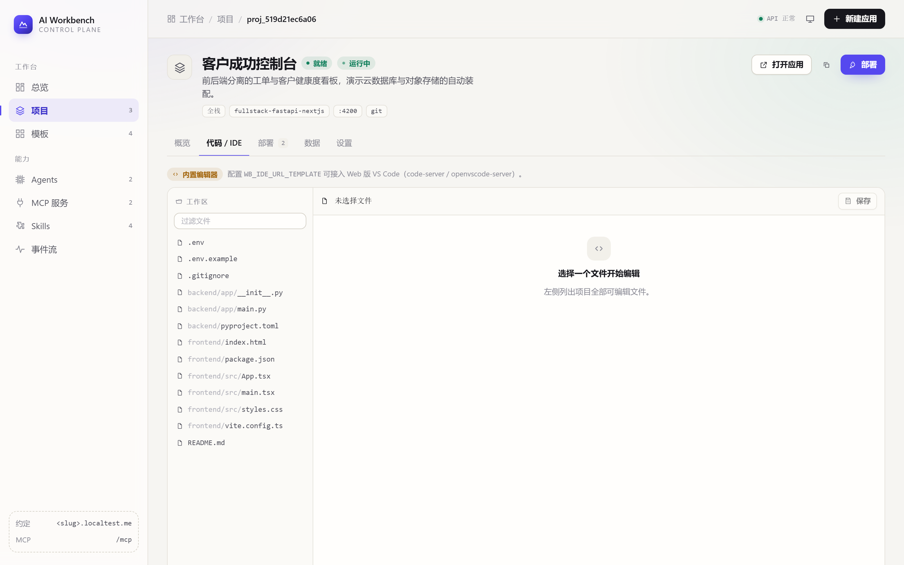
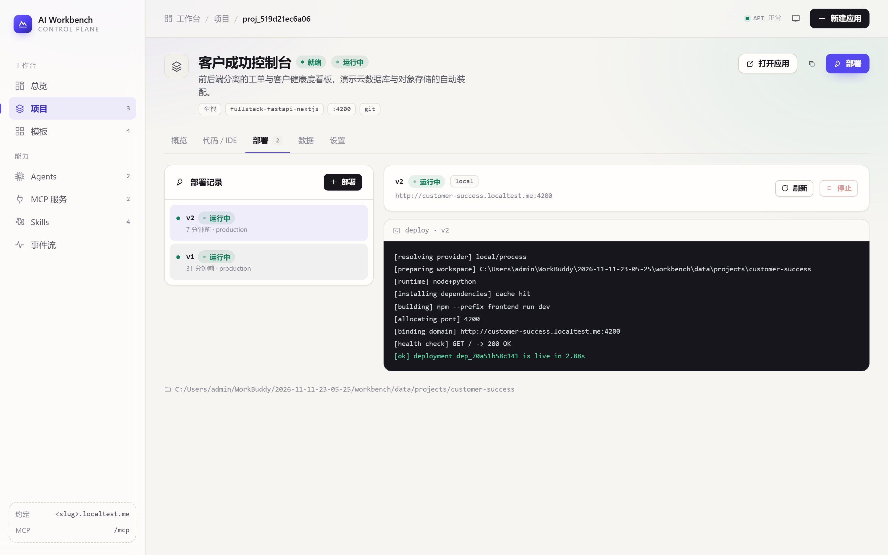
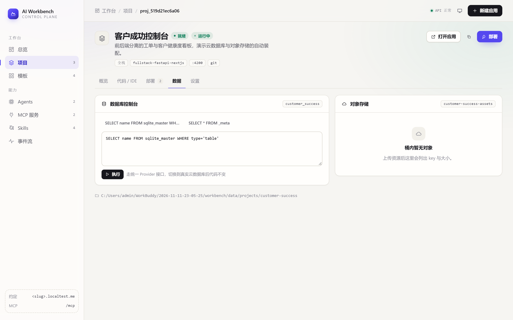
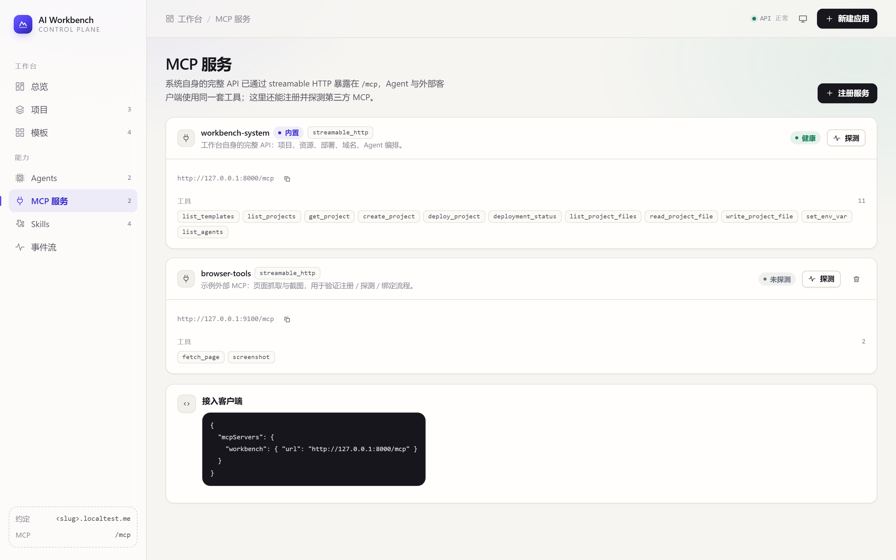
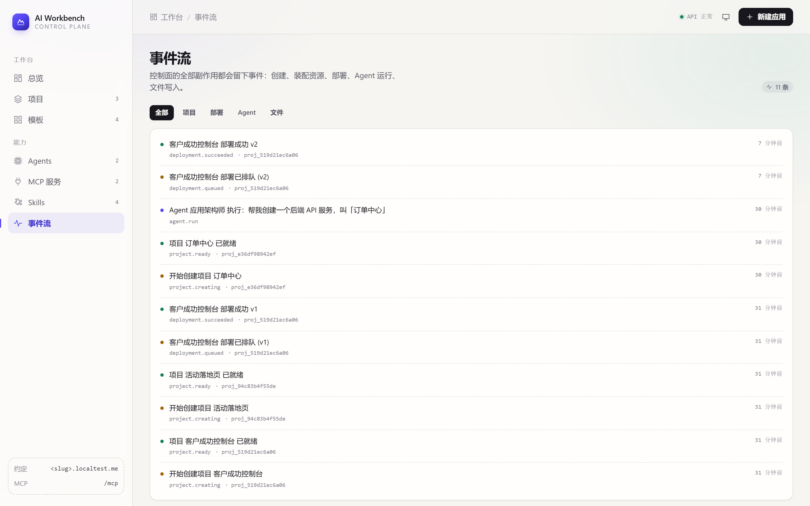

# AI 工作台

**一个可视化控制面：让应用能被创造出来，也能被 AI Agent 持续修改和部署。**

[English](README.md) · [架构设计](docs/architecture.md) · MIT


---

## 为什么做这个

大多数「AI 帮你写应用」的演示到生成代码就结束了。真正难的是之后：应用需要一个桶、一个数据库、一个域名、一堆环境变量、一个部署目标 —— 而 Agent 还需要一套**稳定的程序化接口**，才能在没人点鼠标的情况下继续动它们。

AI 工作台就是这套接口。你可视化创建项目，平台按约定自动装配它需要的一切；同一批操作原样通过 MCP 暴露出去，Agent 可以接着干。**不存在"界面能做但 Agent 做不到"的能力缺口。**

---

## 能力一览

| | |
| --- | --- |
| **可视化创建** | 选模板 → 自动装配对象存储、数据库、`<slug>.<后缀>` 域名 |
| **四套模板、四种形态** | 全栈（FastAPI + Next.js）、纯前端（Vite + React）、纯后端（FastAPI + MCP）、Agent 服务（FastAPI + MCP + Harness） |
| **在线编辑** | 内置文件编辑器开箱可用；配置 `WB_IDE_URL_TEMPLATE` 后自动切换为 iframe 内嵌的 Web 版 VS Code |
| **一键部署** | 带版本号、流式构建日志与健康检查 |
| **资源实操** | 直接对项目自己的数据库跑 SQL；浏览对象存储里的 key |
| **MCP / Skills / Agents** | 三者都是一等公民，以数据形式存储、可视化增删改 |
| **约定大于配置** | 工作区路径、桶名、库名、主域名、端口全部由 slug 推导 |
| **云可替换** | 存储 / 数据库 / DNS / 部署统一在 Provider SPI 之后，换云只改一个环境变量 |

---

## 快速开始

需要 Python ≥ 3.11、[uv](https://docs.astral.sh/uv/)、Node.js ≥ 20。

```bash
git clone <your-repo> ai-workbench && cd ai-workbench

# 1 —— 后端（REST + MCP 同端口 :8000）
cd backend
uv sync
uv run uvicorn app.main:app --reload --port 8000

# 2 —— 前端（:3000），另开一个终端
cd frontend
npm install
npm run dev
```

打开 <http://localhost:3000>。首次启动会写入两个演示项目（`WB_BOOTSTRAP_DEMO_DATA=true`）。

**不需要任何云凭据。** `localtest.me` 把 `*.localtest.me` 泛解析到 `127.0.0.1`，所以 `customer-success.localtest.me` 在浏览器里直接能开，零 DNS 配置。

生成的项目落在 `data/projects/<slug>/`。删掉 `data/` 就是整平台重置。

---

## 走一遍

### 创建项目

选模板 → 填名称 → 可选子域名前缀。底部勾选框会让创建完立刻触发首次部署。


### 一个项目，五个标签页

| 标签 | 内容 |
| --- | --- |
| 概览 | 运行时、已装配云资源、域名绑定、环境变量、最近部署 |
| 代码 / IDE | 文件树 + 编辑器；配了 `WB_IDE_URL_TEMPLATE` 则为内嵌 VS Code |
| 部署 | 部署历史、实时构建日志、停止 / 重新部署 |
| 数据 | 项目数据库的 SQL 控制台、对象存储浏览器 |
| 设置 | 环境变量、自定义域名、删除项目 |


### 改代码

没有外部 IDE 时，内置编辑器直接读写工作区 —— 它调用的 `write_project_file` 和 Agent 调的是同一个函数。



### 部署

部署是异步的：请求立即返回，日志随构建进程增量推送，健康检查决定 `运行中` 还是 `失败`。





### 管理能力层

MCP 服务、Skills、Agents 都是数据行，用 id 相互关联 —— 所以随时能在界面上重组某个 Agent 的能力，不用改代码。




每次变更都会写入全局事件流，工作台顶部的计数就是从这里来的。



---

## MCP 接口

工作台把自己的 MCP 服务挂在 **和 REST 同一个端口**（`/mcp`，streamable HTTP）。工具就是 REST 层在用的那批 Python 函数，不存在两份实现走偏。

```json
{ "mcpServers": { "workbench": { "url": "http://127.0.0.1:8000/mcp" } } }
```

| 工具 | 作用 |
| --- | --- |
| `list_templates` | 可用模板及各自需要的资源 |
| `create_project` | 生成骨架并装配存储、数据库、域名 |
| `list_projects` / `get_project` | 查状态、资源、域名、最近部署 |
| `list_project_files` / `read_project_file` / `write_project_file` | 读写应用代码 |
| `set_env_var` | 改环境变量，下次部署注入 |
| `deploy_project` / `deployment_status` | 触发构建并轮询结果 |
| `list_agents` / `run_workbench_agent` | 把高层目标交给配置好的 Agent |
| `workbench_capabilities` | 返回对象模型与全部约定，让外部 Agent 能安全规划 |

典型 Agent 闭环：

```
list_templates → create_project → write_project_file → deploy_project → deployment_status
```

REST 侧等价物：`/api/v1` 下 45 个端点，<http://localhost:8000/docs> 可直接浏览。

---

## 约定

一切都是从 slug 推出来的 —— "配置" 就是你给项目起的名字。

| 对象 | 规则 |
| --- | --- |
| 工作区 | `data/projects/<slug>` |
| 对象存储桶 | `<slug>-assets` |
| 数据库 | `<slug>` |
| 主域名 | `<slug>.<WB_DOMAIN_SUFFIX>` |
| 本地端口 | `4200–4399` 内首个空闲 |
| 启动命令 | 取自模板，可按项目覆盖 |

---

## 怎么改成你自己的

| 想做的事 | 改哪里 | 要不要动前端 |
| --- | --- | --- |
| 换云（COS / S3 / PostgreSQL / DNSPod / Docker） | 加一个 provider 模块，设 `WB_*_PROVIDER` | 否 |
| 加模板 | `backend/app/services/templates.py` 加一个 dataclass | 否 |
| 加 Agent 可用能力 | 加一个函数并注册进 `TOOLS` | 否 |
| 换真实 LLM 替换规则规划器 | 替换 `agent_runtime.py` 的 `_plan()` | 否 |
| 内嵌真正的 VS Code | 设 `WB_IDE_URL_TEMPLATE` | 否 |
| 加新资源类型（如 Redis） | 新增 provider 能力 + 模板声明 | 是 |

判断标准很简单：只要改动落在 **Provider / Template / Tool** 这个三角里，前端一行都不用动。只有新增"一类实体"才需要。

Provider 用装饰器注册、运行时按名解析：

```python
@register_provider("storage", "s3")
class S3Storage(StorageProvider):
    def create_bucket(self, bucket, *, project_id): ...
```

`GET /api/v1/system/providers` 会列出所有已注册的实现。

---

## 配置

把 `.env.example` 复制成 `.env`。所有键都可选，统一 `WB_` 前缀。

```bash
WB_DOMAIN_SUFFIX=localtest.me    # *.localtest.me -> 127.0.0.1
WB_DEPLOY_MODE=simulate          # simulate | process
WB_STORAGE_PROVIDER=local        # 可换成 s3 / cos / oss ...
WB_IDE_URL_TEMPLATE=             # code-server 入口，支持 {path} {project}
WB_DATA_DIR=./data               # 项目、桶、数据库、DNS 区
```

`WB_DEPLOY_MODE=process` 会真的在分配端口上起子进程；`simulate`（默认）只产出贴近真实的构建日志，不启动任何东西。

---

## 目录结构

```
backend/
  app/
    api/           projects · platform · registry · system
    services/      scaffold · templates · deployments · system_tools · agent_runtime
    providers/     base（SPI + 注册表）+ local/{storage,database,domain,deploy}
    mcp/server.py  fastmcp 服务端，与 REST 同端口
    models.py      9 张表
frontend/
  app/             10 个路由，/projects/[id] 下五个标签页
  components/      Rail · Topbar · CreateProjectDialog · LogViewer · Icon（全 SVG）
  lib/             api · types · format
docs/architecture.md   设计取舍、数据模型、扩展点
scripts/shoot.mjs      端到端走查脚本，上面的截图由它生成
```

---

## 已知限制

单用户、无鉴权 · SQL 控制台无沙箱 · Agent 规划器是规则驱动而非 LLM · 前端文案仅中文、暂未 i18n · 同项目并发部署未加锁 · 项目创建跨 Provider 非原子。

每一条的推荐解法见[架构文档 §11](docs/architecture.md#11-已知限制与下一步)。

---

## 许可证

MIT —— 见 [LICENSE](LICENSE)。
