# AI 工作台

**一个可视化控制面：让应用能被创造出来，也能被 AI Agent 持续修改和部署。**

[English](README.md) · [架构设计](docs/architecture.md) · MIT

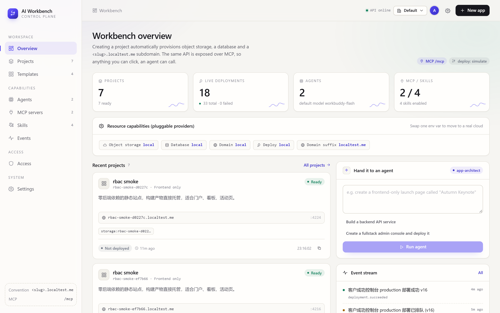

---

## 为什么做这个

大多数「AI 帮你写应用」的演示到生成代码就结束了。真正难的是之后：应用需要一个桶、一个数据库、一个域名、一堆环境变量、一个部署目标 —— 而 Agent 还需要一套**稳定的程序化接口**，才能在没人点鼠标的情况下继续动它们。

AI 工作台就是这套接口。你可视化创建项目，平台按约定自动装配它需要的一切；同一批操作原样通过 MCP 暴露出去，Agent 可以接着干。**不存在"界面能做但 Agent 做不到"的能力缺口。**

---

## 能力一览

| | |
| --- | --- |
| **可视化创建** | 选模板 → 自动装配对象存储、数据库、`<slug>.<后缀>` 域名 |
| **四套模板、四种形态** | 全栈（FastAPI + Next.js）、纯前端（Vite + React）、纯后端（FastAPI + MCP）、Agent 服务（FastAPI + MCP + Harness） |
| **项目内可视化改代码** | 文件树 + 语法高亮编辑器，零额外依赖；写盘走的就是 Agent 用的 `write_project_file` |
| **真正的调试环境** | 每个项目独占 `<slug>-dev.<后缀>`：自己的端口、自己的进程、热更新；面板内直接内嵌运行结果 |
| **界面里的版本控制** | 暂存、看 diff、提交、还原单文件、回滚提交 —— git 是事实来源，不是附加功能 |
| **发布 = 提交 → 打标签 → 部署** | 发布时打 `deploy/v<N>` 标签并部署那个 sha，「线上是哪一版」是可指向的 git 对象 |
| **一键部署** | 带版本号、流式构建日志与健康检查 |
| **资源实操** | 直接对项目自己的数据库跑 SQL；浏览对象存储里的 key |
| **MCP / Skills / Agents** | 三者都是一等公民，以数据形式存储、可视化增删改 |
| **真 Agent，也可离线** | 规划器可插拔：配一个 OpenAI 兼容端点，Agent 就真的在工具调用上推理；没有 Key 时自动退回规则规划器 |
| **有护栏的数据库控制台** | 默认只读：语句白名单 + `ATTACH` / `load_extension` / `writable_schema` 黑名单 |
| **组织 + 完整 RBAC** | 35 项权限目录上的五个内置角色、自定义角色、项目级授权、邀请、停用、审计流水 —— 一张路由表同时守住 REST 与 `/mcp` |
| **SSO：CAS / OAuth2 / OIDC / 企微 / 钉钉** | 每种连接都是数据，在界面上配置、用真实探测验证；首次登录即建号，支持 IdP 分组到角色的映射 |
| **约定大于配置** | 三类项目规范文档（全栈 / 纯前端 / 纯后端）同时驱动脚手架、合规报告、预览命令与 Agent 提示词，只有一份定义 |
| **云可替换** | 存储 / 数据库 / DNS / 部署统一在 Provider SPI 之后，换云只改一个环境变量 |
| **双语 · 主题 · 可换导航** | 中英文（默认英文）、跟随系统/浅色/深色主题、导航可在侧边栏或顶栏之间切换 |

---

## 快速开始

需要 Python ≥ 3.11、[uv](https://docs.astral.sh/uv/)、Node.js ≥ 20，以及 `PATH` 里的 git（发布与版本控制直接调它）。

```bash
git clone <your-repo> ai-workbench && cd ai-workbench

# 1 —— 后端（REST + MCP 同端口 :8000）
cd backend
uv sync
uv run uvicorn app.main:app --reload --port 8000

# 2 —— 前端（:3000），另开一个终端
cd frontend
npm install
npm run dev
```

打开 <http://localhost:3000>。首次启动会写入两个演示项目（`WB_BOOTSTRAP_DEMO_DATA=true`）。

**不需要任何云凭据。** `localtest.me` 把 `*.localtest.me` 泛解析到 `127.0.0.1`，所以 `customer-success.localtest.me` 在浏览器里直接能开，零 DNS 配置。

鉴权默认关闭 —— 打开页面不需要登录，本机上这样最省事。想看组织、角色、SSO 的真实效果，就打开它并播一个演示租户（播种脚本只走公开 API，真实租户也是这么建起来的）：

```bash
cd backend
WB_AUTH_ENABLED=true uv run uvicorn app.main:app --port 8000   # 终端 1

uv run python tools/access_demo.py                             # 终端 2
# → owner@acme.test / workbench-demo-1，然后打开 /access
```

生成的项目落在 `data/projects/<slug>/`。删掉 `data/` 就是整平台重置。

---

## 走一遍

### 创建项目

选模板 → 填名称 → 可选子域名前缀。底部勾选框会让创建完立刻触发首次部署。

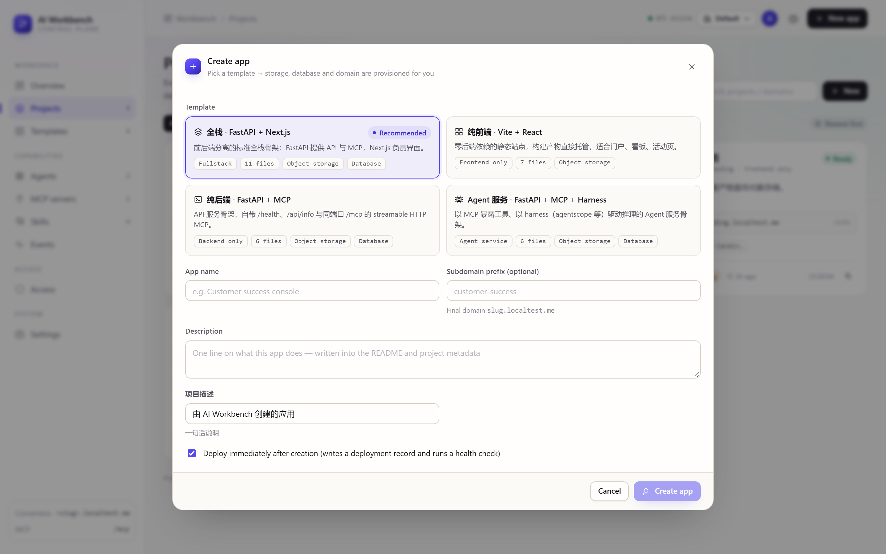

### 一个项目，八个标签页

| 标签 | 内容 |
| --- | --- |
| 概览 | 运行时、已装配云资源、域名绑定、环境变量、最近部署 |
| 代码 | 文件树 + 编辑器；可新建、保存、删除、还原单个文件 |
| 调试 | `<slug>-dev.<后缀>` 上的实时预览，启动 / 停止 / 重启，流式日志，发布 |
| 版本 | 工作区状态、diff、提交历史、提交、回滚 |
| 部署 | 部署历史、实时构建日志、停止 / 重新部署 |
| 数据 | 项目数据库的 SQL 控制台、对象存储浏览器 |
| 规范 | 类型规范、通过/告警/失败报告、解析后的命令、覆盖文件 |
| 设置 | 环境变量、自定义域名、删除项目 |

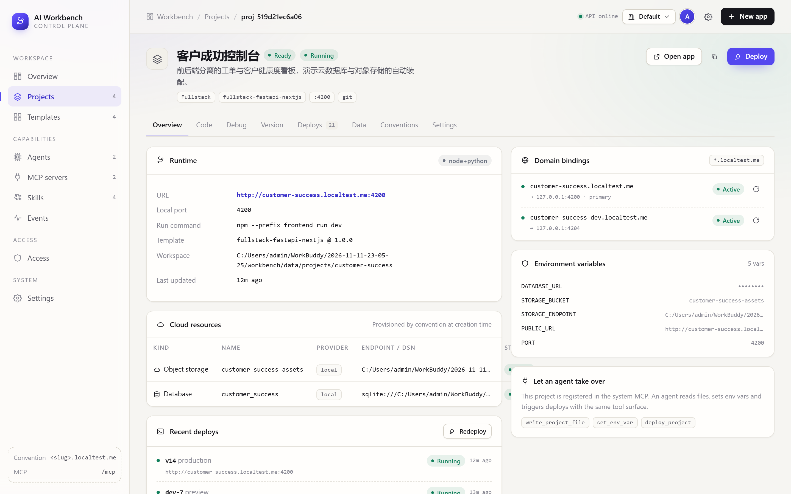

### 改代码

编辑器是一个透明 `<textarea>` 叠在与它字体度量完全一致的已高亮 `<pre>` 上 ——
不用 Monaco、不用 CodeMirror、不加任何依赖。高亮是按语言的粘性正则分词，与行号槽
滚动同步；`Ctrl/⌘+S` 保存，`Tab` / `Shift+Tab` 缩进，`Enter` 自动缩进。

它写盘调用的就是 Agent 调用的 `write_project_file`，不存在只有界面能走的特权路径。

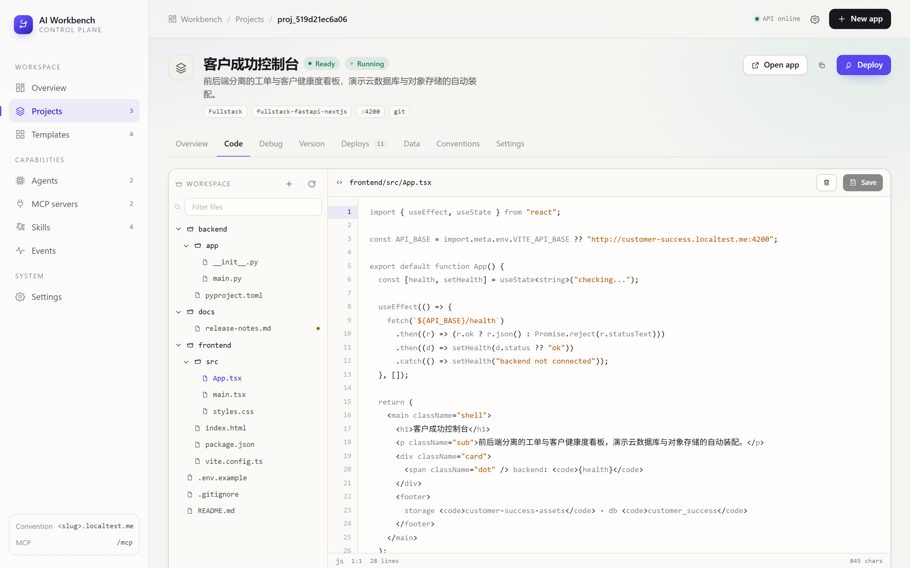

### 调试：`<slug>-dev`

调试环境不是部署的一个模式，而是一套独立环境：独立端口、独立进程、独立域名，
所以重启预览永远压不到生产。

```
生产  http://customer-success.localtest.me:4200
预览  http://customer-success-dev.localtest.me:4204   ← WB_PREVIEW_SUFFIX=-dev
```

它只朝一个方向降级，而且会明确告诉你降到了哪一级：

1. **dev server** —— 真的跑解析出的 `dev_command`（带热更新）。
2. **静态宿主** —— 还没装 `node_modules`/`.venv`，那就按 `dist/` → `build/` →
   `out/` → 已编译 `index.html` 的顺序托管。
3. **说明页** —— 连能托管的东西都没有，就渲染文件树、README 和需要执行的确切命令，
   而不是丢给你一个死端口。

实际用到的模式会记在部署行上并显示为标签（上图是 `static:explainer`），
所以截图不会说谎。

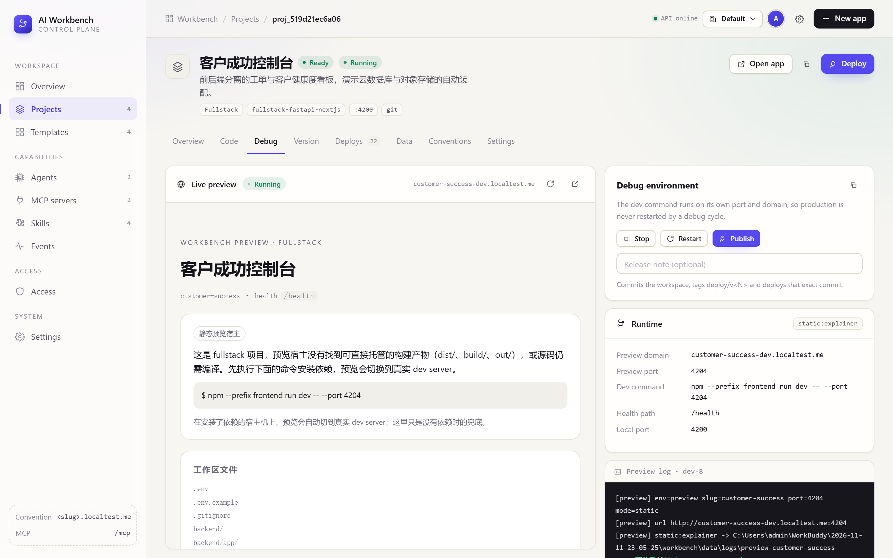

### 版本控制与发布

git 不是外挂：工作区从创建起就是一个仓库，每次发布都是
`提交 → 打 deploy/v<N> 标签 → 部署那个 commit_sha`，并把 sha 记在部署行上。
所以回滚就是一次普通 revert，而不是去猜「哪个目录才是线上」。

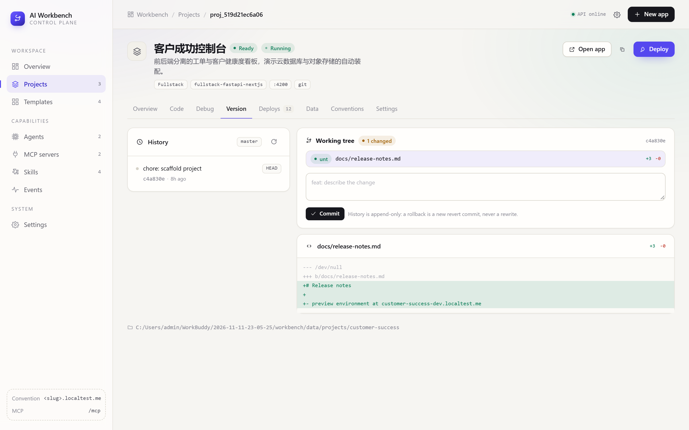

### 规范是被检查的

类型规范是可执行的数据，不是文档里的句子。每个项目类型一个 `TypeSpec`，
同时驱动模板渲染、合规报告、预览命令和 Agent 系统提示词 ——
所以文档、界面和 Agent 不可能各自漂移。

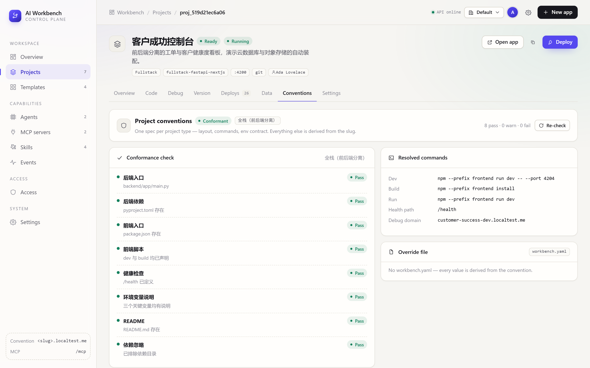

完整规范：**[docs/conventions/](docs/conventions/README.md)** ——
[全栈](docs/conventions/fullstack.md) ·
[纯前端](docs/conventions/frontend.md) ·
[纯后端](docs/conventions/backend.md)。

### 部署

部署是异步的：请求立即返回，日志随构建进程增量推送，健康检查决定 `运行中` 还是 `失败`。浏览器通过 **SSE**（`/deployments/{id}/stream`）收日志，没有轮询间隔要调；同一项目已有部署在跑时，再次触发会被 `409` 拒绝。

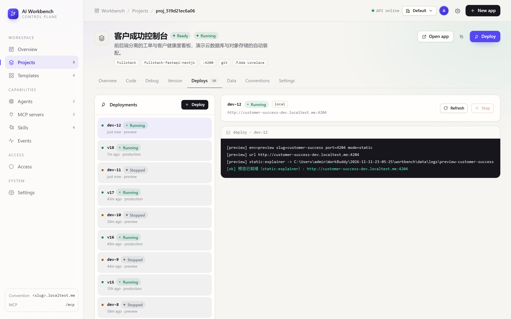

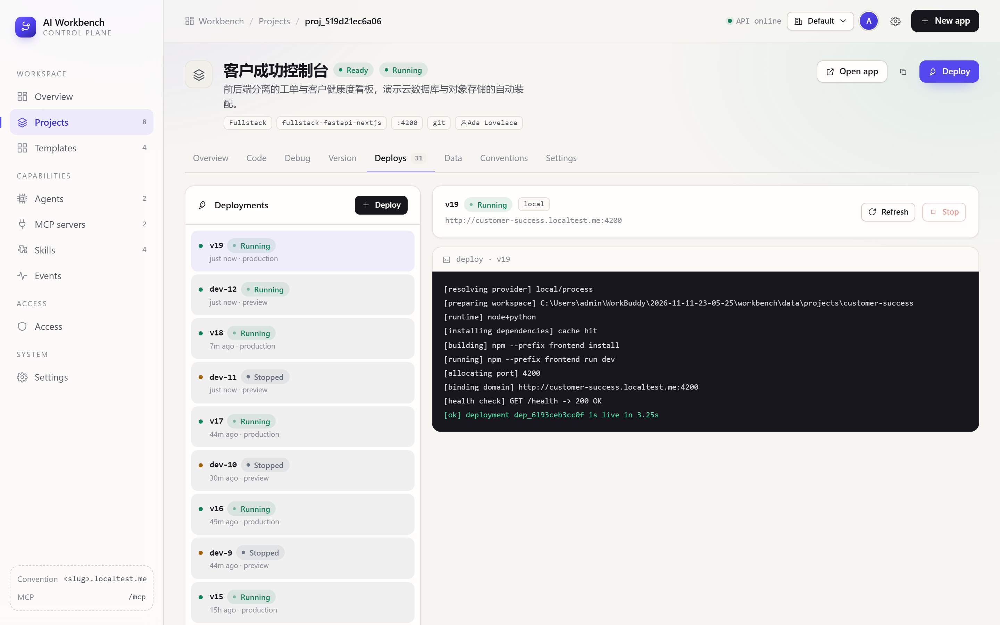

数据标签页通过和真实云同一套 Provider 接口访问项目自己的库。控制台**默认只读**：`DROP`、`ATTACH`、`PRAGMA writable_schema` 在执行前就被拦下。

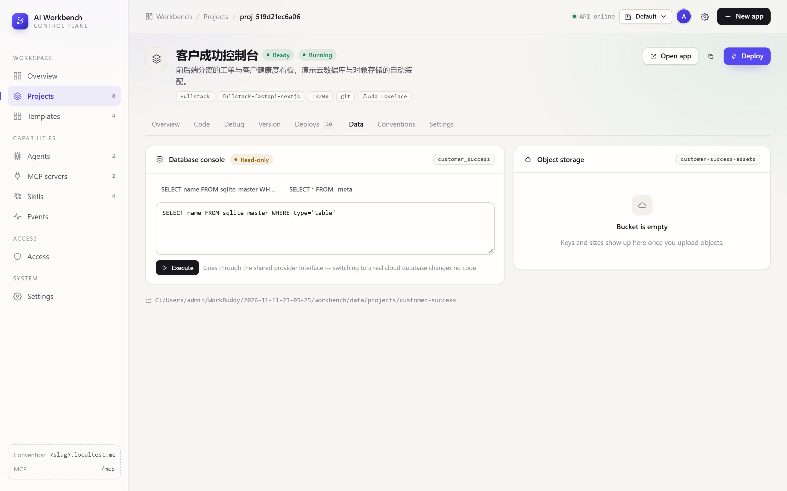

### 管理能力层

MCP 服务、Skills、Agents 都是数据行，用 id 相互关联 —— 所以随时能在界面上重组某个 Agent 的能力，不用改代码。

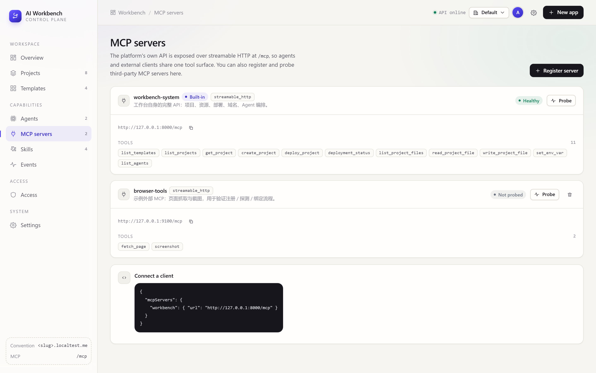

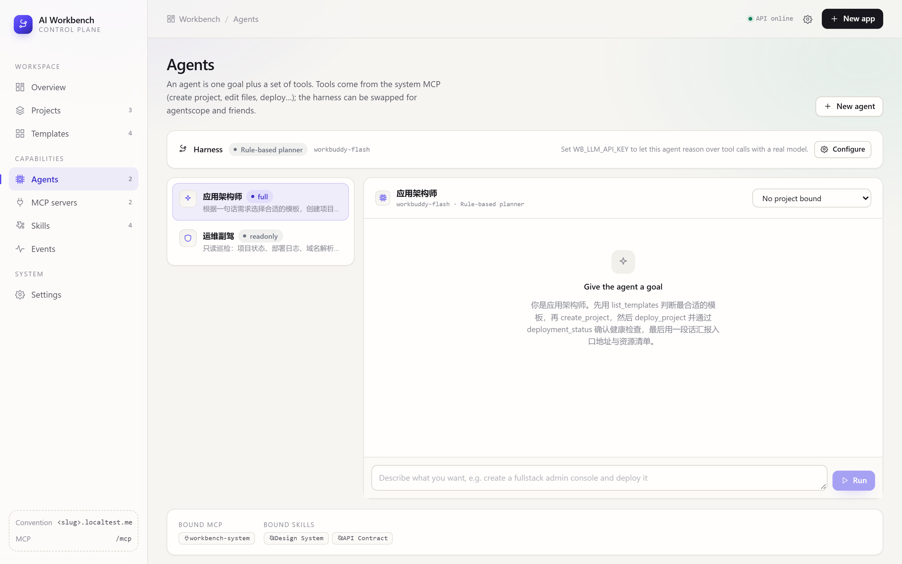

每次变更都会写入全局事件流，工作台顶部的计数就是从这里来的。

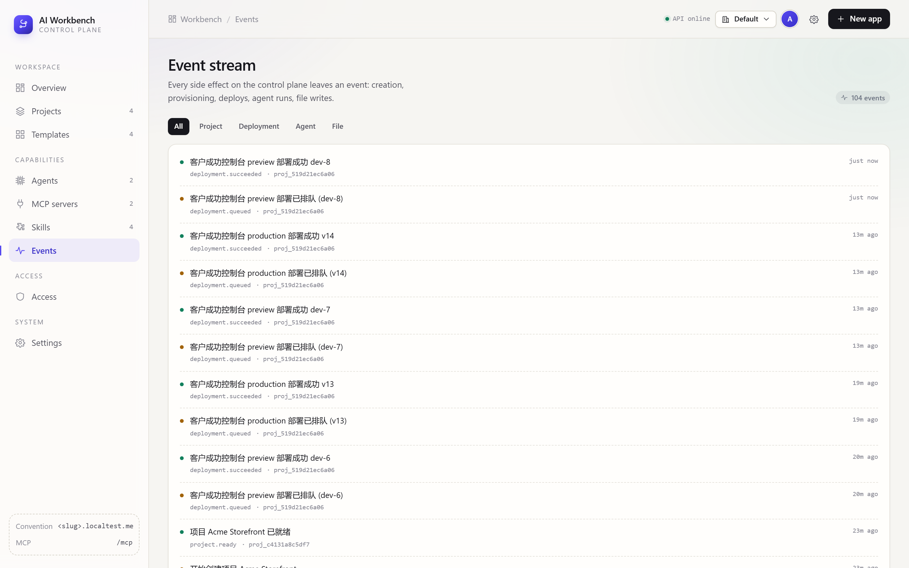

### 偏好设置

一个弹层同时管语言、主题、导航位置。三项都持久化到 localStorage，并在 hydration
之前应用，所以不会出现"先闪一下错误主题"。

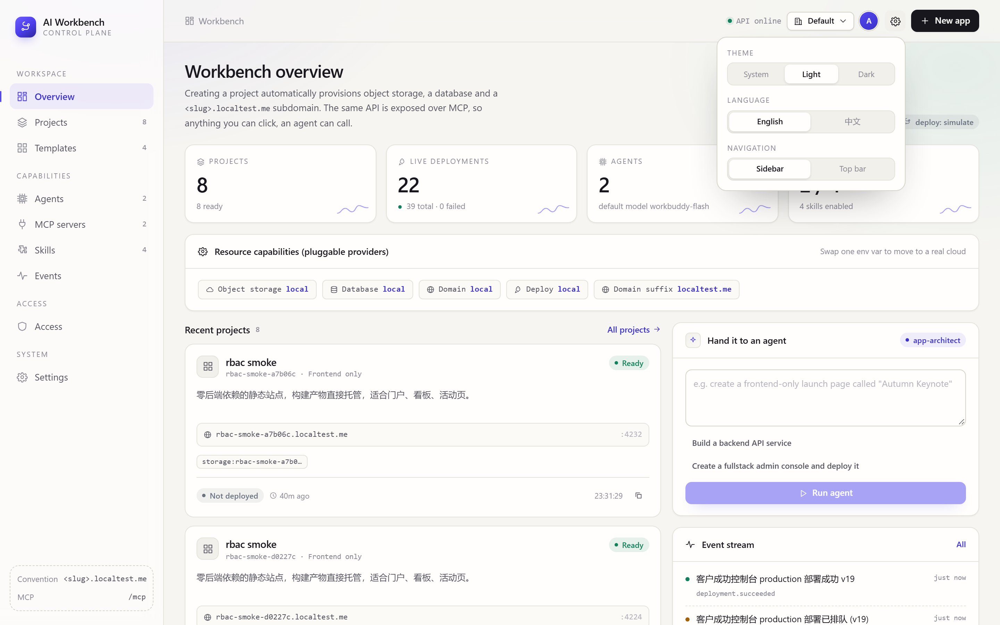

选「顶栏」会把导航整体搬到 header 里，释放侧边栏宽度给内容——宽屏上更划算。

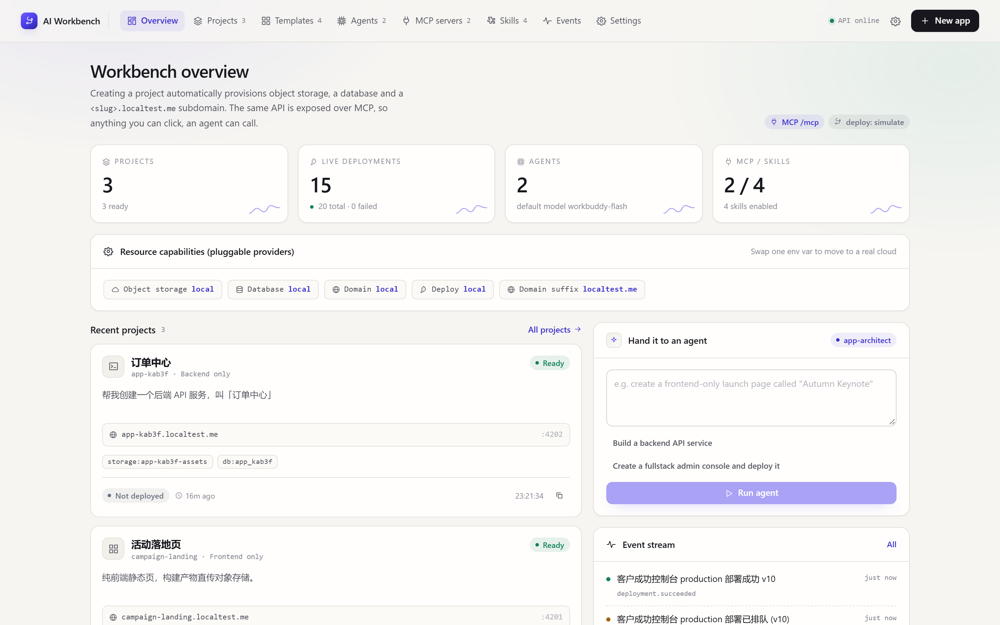

同一套界面切到英文：


---

## 国际化

`lib/i18n.tsx` 里是一张扁平字典，且**键由英文对象推导**：`MessageKey` 从 `en` 生成，
因此拼错键是编译错误，`zh` 少一条也是编译错误。日期与相对时间跟随当前语言，
状态徽章存的是消息键而不是硬编码文案。

```tsx
const { t, locale } = useI18n();
t("dash.kpi.projectsFoot", { ready: 3 });   // "3 ready" / "3 个就绪"
relativeTime(project.updated_at, locale);   // "2h ago" / "2 小时前"
```

新增一门语言 = 加一个对象 + 在 `LOCALES` 里加一项。

---

## MCP 接口

工作台把自己的 MCP 服务挂在 **和 REST 同一个端口**（`/mcp`，streamable HTTP）。工具就是 REST 层在用的那批 Python 函数，不存在两份实现走偏。

```json
{ "mcpServers": { "workbench": { "url": "http://127.0.0.1:8000/mcp" } } }
```

| 工具 | 作用 |
| --- | --- |
| `describe_workbench` | 约定、Provider、模板、规划器与工具清单 —— 建议第一把就调它 |
| `list_templates` | 可用模板及各自需要的资源 |
| `create_project` | 生成骨架并装配存储、数据库、域名（生产与预览各一套） |
| `list_projects` / `get_project` | 查状态、资源、域名、最近部署 |
| `list_project_files` / `read_project_file` / `write_project_file` / `delete_project_file` | 读写、删除应用代码 |
| `search_project` | 整个工作区搜索字符串，返回路径、行号与该行内容 |
| `check_project_conventions` | 按类型规范给工作区打分 —— 改代码和发布前先跑它 |
| `start_preview` / `stop_preview` / `preview_status` | 驱动 `<slug>-dev` 调试环境 |
| `run_project` | 用当前工作区跑生产命令 |
| `publish_project` | 提交 → 打 `deploy/v<N>` 标签 → 部署那个提交 |
| `deploy_project` / `deployment_status` | 触发普通部署并轮询 |
| `git_status` / `git_log` / `git_diff` | 查工作区状态、历史与 diff |
| `git_commit` / `git_restore_file` / `git_revert_commit` | 提交、丢弃单文件改动、用 revert 回滚 |
| `list_env_vars` / `set_env_var` | 查看与修改环境变量，下次部署注入 |
| `query_database` | 对项目数据库执行受护栏约束的只读查询 |
| `add_domain` | 给项目再绑一个域名 |
| `list_agents` | 查看已配置 Agent 及其 MCP 服务与 Skills |

典型 Agent 闭环 —— 和人点的是同样五个动作：

```
describe_workbench → check_project_conventions → write_project_file
                   → start_preview → publish_project
```

REST 侧等价物：`/api/v1` 下 55 个端点，<http://localhost:8000/docs> 可直接浏览。

---

## 三类项目规范

`backend/app/services/conventions.py` 里每个项目类型一个 `TypeSpec`。
它是唯一知道「全栈项目意味着什么」的地方，其余全部读它。

| 类型 | 目录布局 | 调试命令 | 健康检查 |
| --- | --- | --- | --- |
| `fullstack` | `backend/` + `frontend/` | `npm --prefix frontend run dev -- --port {dev_port}` | `/health` |
| `frontend` | 单个 Vite 应用 | `npm run dev -- --port {dev_port}` | `/` |
| `backend` | 仅 FastAPI | `python -m uvicorn app.main:app --host 0.0.0.0 --port {port} --reload` | `/health` |

同一定义在五个地方生效：脚手架、**规范**标签页（`GET /projects/{id}/conventions`）、
`check_project_conventions` 工具、预览命令解析、发布闸门。

工作区确实需要不一样时，只有一个官方认可的覆盖文件，放在项目根：

```yaml
# workbench.yaml
type: fullstack
dev_command: npm --prefix frontend run dev -- --port {port}
health_path: /healthz
preview_suffix: -sigma
```

---

## Agent 运行时

内置两个规划器，按配置自动选择：

| 规划器 | 生效条件 | 行为 |
| --- | --- | --- |
| `llm` | 配了 `WB_LLM_API_KEY`（或显式 `WB_AGENT_HARNESS=llm`） | 对任意 OpenAI 兼容 `/chat/completions` 端点做真实 function calling |
| `local` | 其余情况 | 关键词意图路由，能力齐全但理解力有限 |

工具 schema 是**从 REST 层已经在用的 Python 签名和 docstring 生成**的 —— 一个 Agent 能力与一个 API 端点就是同一个对象。模型端点中途失联时，运行时会把它记成一步失败、自动降级到本地规划器并打标，你拿到的是答案而不是一个红色错误。

```bash
# OpenAI / Azure / vLLM / Ollama / 通义兼容模式，同一个客户端
WB_LLM_BASE_URL=https://api.openai.com/v1
WB_LLM_API_KEY=sk-...
WB_LLM_MODEL=gpt-4o-mini
```

`backend/tools/mock_llm.py` 是一个会回放工具调用的假端点，整条链路可以离线验证：

```bash
python tools/mock_llm.py                       # :8811
WB_LLM_BASE_URL=http://127.0.0.1:8811/v1 WB_LLM_API_KEY=test uv run uvicorn app.main:app
```

系统设置页的「测试连通性」会真发一次请求并回显模型答复。

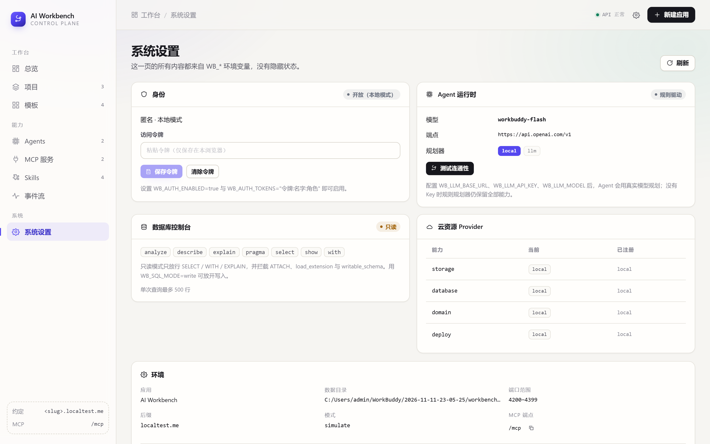

---

## 访问控制

默认关闭（本地工作台不该为了打开一个页面先要凭据）。打开后，每个请求 —— REST 和挂载的 MCP —— 都按同一份权限目录判权：

```bash
WB_AUTH_ENABLED=true
WB_AUTH_ALLOW_SIGNUP=true          # 新组织的第一个注册者成为 owner
```

**组织就是租户边界。** 用户通过一条只带一个角色的成员关系属于某个组织；会话同一时刻只钉在一个组织上，右上角菜单负责切换。这条线不穿透 —— 把路径里的 id 改成别的组织，A 组织的管理员拿到的是 `404`，连 B 是否存在都不确认。

**角色就是权限目录里的一组名字**（共 35 项：`deploy:publish`、`sso:manage`、`member:manage` ……）。每个组织自带五个 —— `owner` `admin` `developer` `operator` `viewer` —— 也可以在界面上用勾选表自己加。没有继承需要推演：有效权限就是你组织角色与项目级授权的并集。

| 层 | 决定什么 |
| --- | --- |
| 中间件 | 用方法 + 路径查路由表得出权限，`/mcp` 因此自动继承 REST 的策略而不会各自漂移；未登记的写操作一律拒绝 |
| 处理器 | 再用 URL 里的组织校验主体，然后校验权限。拒绝在 403 发出**之前**就落审计 |

**权限管"能不能做"，数据范围管"对谁的做"。** 每个角色还带一个数据范围：`all` 覆盖组织内全部项目，`own` 只覆盖自己拥有或被授权的项目。于是开发者和管理员可以持有同一项 `code:write`，看到的却是不同的一批工作区 —— 开发者的列表里只有自己的活儿加上别人明确共享的。判定只有一处实现（`Principal.reaches`），列表过滤、详情（返回 `404` 而不是 `403`）、MCP 工具守卫、Agent 运行时都调它，所以"Agent 能做的恰好等于调用它的人能做的"是字面成立的。连计数也按范围走 —— 徽标里的数字也是数据。

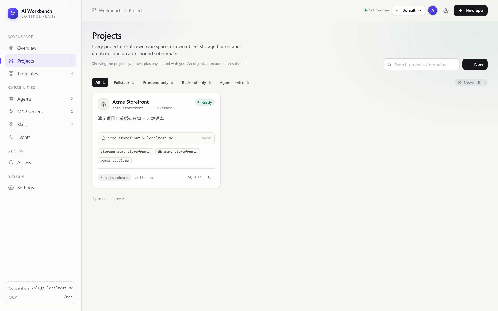

会话是不透明 Bearer 令牌（`wbs_…`，落库只存 SHA-256，12 小时滑动续期），口令用标准库 scrypt。下面这些都在 `/access` 一页里 —— 成员、角色、SSO、审计、设置五个标签，缺哪个权限就少哪个标签：

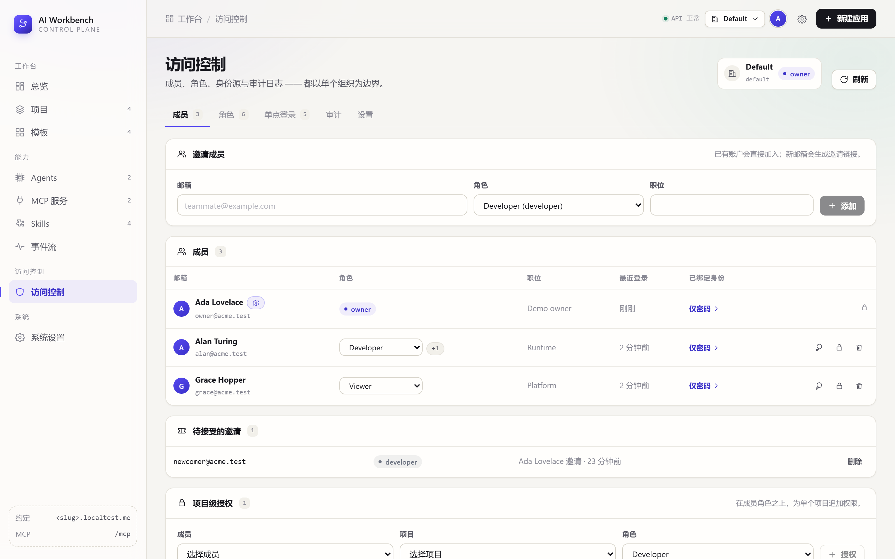

角色就地编辑，内置角色也能改（`owner` 除外，它必须保持全量，否则组织会把自己锁死）：

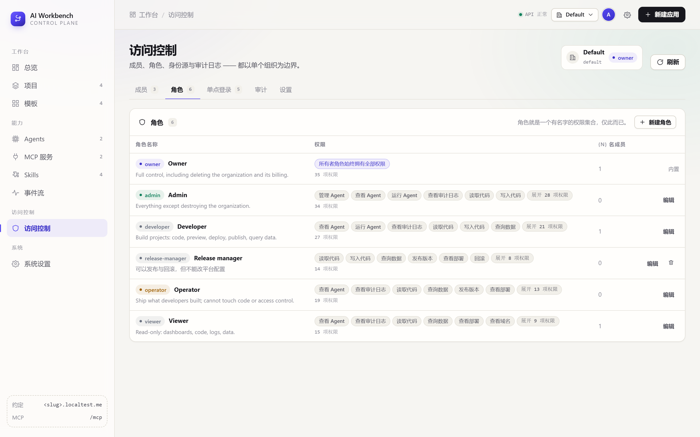

### 单点登录

五种连接，全部可插拔、全部以数据形式配置 —— 加一种是在库里加一行，不是发版：

| 类型 | 流程 | 关键点 |
| --- | --- | --- |
| **OIDC** | discovery → 用 JWKS 校验 `id_token` | PKCE S256，校验 `iss`/`aud`/`nonce`，拒绝 `alg=none` |
| **OAuth2** | 授权 → 取令牌 → userinfo | 声明名可配，映射到姓名 / 邮箱 / 分组 |
| **CAS** | `serviceValidate`（或 `p3/`）XML | state 藏在 `service` URL 里；代理票据会被拒绝 |
| **企微** | 扫码登录或企微内 OAuth | 两种场景对应两个不同域名，自动选择 |
| **钉钉** | `oauth2/userAccessToken` → `contact/users/me` | 主体取 `unionId`，换应用不换人 |

每条连接都有界面里复制得到的回调地址、一次真发请求的「测试连接」（只存过但没验过是 `unchecked`，绝不谎报 `ready`）、IdP 分组到角色的映射，以及首次登录即建号：

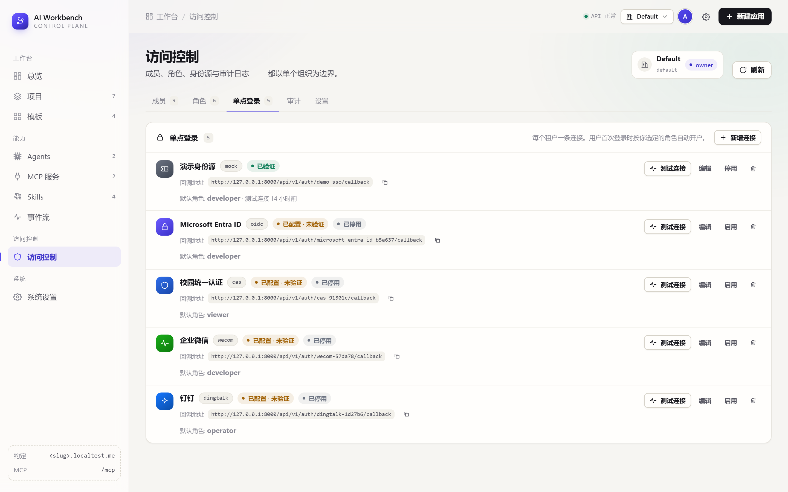

工作台还自带一个 OIDC 形状的模拟 IdP（`/api/v1/auth/mock/authorize`），走的是**真实**的 state → code → token → profile 链路 —— 整条流程可以离线、可以在 CI 里跑：

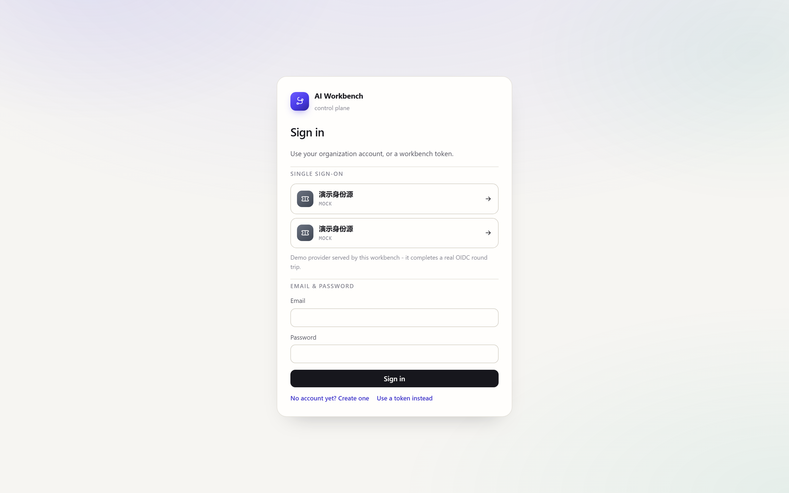

完整手册 —— 权限目录、路由表、每种连接的字段说明、纯 SSO 部署的引导流程：[docs/access.md](docs/access.md)。

---

## 约定

一切都是从 slug 推出来的 —— "配置" 就是你给项目起的名字。

| 对象 | 规则 |
| --- | --- |
| 工作区 | `data/projects/<slug>` |
| 对象存储桶 | `<slug>-assets` |
| 数据库 | `<slug>` |
| 主域名 | `<slug>.<WB_DOMAIN_SUFFIX>` |
| 预览域名 | `<slug><WB_PREVIEW_SUFFIX>.<WB_DOMAIN_SUFFIX>`，默认后缀 `-dev` |
| 端口 | 两个，`4200–4399` 内前两个空闲（生产 + 预览） |
| 命令 | 取自类型规范，可在 `workbench.yaml` 覆盖 |
| 发布 | 在部署的提交上打 `git tag deploy/v<N>` |

完整设计说明与逐类型细节：[docs/conventions/](docs/conventions/README.md)。

---

## 怎么改成你自己的

| 想做的事 | 改哪里 | 要不要动前端 |
| --- | --- | --- |
| 换云（COS / S3 / PostgreSQL / DNSPod / Docker） | 加一个 provider 模块，设 `WB_*_PROVIDER` | 否 |
| 加模板 | `backend/app/services/templates.py` 加一个 dataclass | 否 |
| 加 Agent 可用能力 | 加一个函数并注册进 `TOOLS`，REST / MCP / Agent 同时获得 | 否 |
| 加一类项目 | `conventions.py` 加一个 `TypeSpec`，`templates.py` 加对应模板 | 否 |
| 换 Agent 框架（agentscope、langgraph） | 继承 `Harness` 并 `register_harness` | 否 |
| 换模型供应商 | 设 `WB_LLM_BASE_URL` / `WB_LLM_MODEL` | 否 |
| 放开 SQL 控制台 | `WB_SQL_MODE=write` | 否 |
| 加角色 | `/access` 里的角色编辑器，是库里一行，不是一次发版 | 否 |
| 加一种 SSO | 继承 `IdP` 加一个 `SCHEMA` 字典，界面表单自己长出来 | 否 |
| 加一项权限 | `core/permissions.py` 加一行，API、角色编辑器、路由表、Agent 提示词全都跟着走 | 否 |
| 内嵌真正的 VS Code | 设 `WB_IDE_URL_TEMPLATE` | 否 |
| 新增一门语言 | `lib/i18n.tsx` 加一个对象 | 否 |
| 加新资源类型（如 Redis） | 新增 provider 能力 + 模板声明 | 是 |

判断标准很简单：只要改动落在 **Provider / Template / Tool** 这个三角里，前端一行都不用动。只有新增"一类实体"才需要。

Provider 用装饰器注册、运行时按名解析：

```python
@register_provider("storage", "s3")
class S3Storage(StorageProvider):
    def create_bucket(self, bucket, *, project_id): ...
```

`GET /api/v1/system/providers` 会列出所有已注册的实现。

---

## 配置

把 `.env.example` 复制成 `.env`。所有键都可选，统一 `WB_` 前缀。

```bash
WB_DOMAIN_SUFFIX=localtest.me    # *.localtest.me -> 127.0.0.1
WB_PREVIEW_SUFFIX=-dev           # -> <slug>-dev.localtest.me
WB_PREVIEW_MODE=auto             # auto | process | static
WB_PREVIEW_TIMEOUT=25            # 等待 dev server 的秒数，超时回退静态宿主
WB_DEPLOY_MODE=simulate          # simulate | process
WB_STORAGE_PROVIDER=local        # 可换成 s3 / cos / oss ...
WB_IDE_URL_TEMPLATE=             # 可选 code-server 入口，支持 {path} {project}
WB_DATA_DIR=./data               # 项目、桶、数据库、DNS 区

WB_AGENT_HARNESS=auto            # auto | local | llm
WB_LLM_BASE_URL=https://api.openai.com/v1
WB_LLM_API_KEY=                  # 配了它，Agent 就用真实模型规划
WB_LLM_MODEL=

WB_SQL_MODE=readonly             # readonly | write
WB_AUTH_ENABLED=false            # true -> 需要登录，REST 与 /mcp 同时生效
WB_AUTH_ALLOW_SIGNUP=true        # false -> 只能靠邀请与 SSO 进人
WB_AUTH_SESSION_HOURS=12         # 会话滑动有效期
WB_AUTH_DEFAULT_ORG=default      # 新账号落在哪个组织
WB_PUBLIC_API_BASE=              # 浏览器访问 API 的地址（SSO 回调要用）
WB_FRONTEND_URL=http://localhost:3000
```

`WB_DEPLOY_MODE=process` 会真的在分配端口上起子进程；`simulate`（默认）只产出贴近真实的构建日志，不启动任何东西。预览跟随 `WB_DEPLOY_MODE`，除非 `WB_PREVIEW_MODE` 另有指定 —— 而且它总会回退到静态宿主，不会把一个死端口丢进 iframe。

表结构变更在启动时按前向兼容方式自动应用（`app/core/migrate.py`）：只加列、只建幂等索引，没有需要记住的迁移步骤。

---

## 目录结构

```
backend/
  app/
    api/           auth · orgs · projects · workspace · platform · registry · system
    core/          config · db · security · permissions · passwords · context
                   migrate · errors · ids
    services/      conventions · scaffold · templates · deployments · gitops
                   identity · audit · system_tools · agent_runtime · llm · sql_guard
    providers/     base（SPI + 注册表）+ local/{storage,database,domain,deploy,static_host}
                   auth/{base,cas,oauth2(OIDC),wecom,dingtalk}
    mcp/server.py  fastmcp 服务端，与 REST 同端口
    models.py      21 张表
  tools/           mock_llm.py · auth_smoke.py · access_demo.py
frontend/
  app/             13 个路由，/projects/[id] 下八个标签页
  components/      Shell · Rail · Topbar · NavLinks · Preferences · SessionMenu
                   AuthGate · CreateProjectDialog · LogViewer · CodeEditor
                   access/{Members,Roles,Sso,Audit,Settings}Panel · Icon（全 SVG）
  lib/             api · session · auth · access · types · format · i18n · prefs · nav
docs/architecture.md   设计取舍、数据模型、扩展点
docs/access.md         RBAC、组织、SSO 的运维手册
docs/conventions/      三类项目规范 + 「约定大于配置」的来龙去脉
scripts/shoot.mjs      端到端走查脚本，上面的截图由它生成
```

---

## 已知限制

预览宿主跑在**控制面进程内**，所以重启后端会带走所有预览 —— 状态接口能发现端口已死并诚实报成 `stopped`，但不会自动拉起 · 内置编辑器没有多文件搜索替换 · 授权做到了组织级与项目级，再往下的单资源 ACL 没有 · IdP 分组映射依赖对方真的把 groups 声明发过来，且没有 SCIM，离职的人要到我们这里停用或等会话过期才失效 · SQL 护栏是首关键字白名单而非真正的解析器 · 部署串行化只在单进程内有效，多副本仍可能竞争 · MCP 鉴权依赖客户端主动带 Bearer 头 · Agent 写文件没有影子副本，`write_project_file` 前没有 dry-run。

每一条的推荐解法见[架构文档 §14](docs/architecture.md#14-已知限制与下一步)。

---

## 许可证

MIT —— 见 [LICENSE](LICENSE)。
