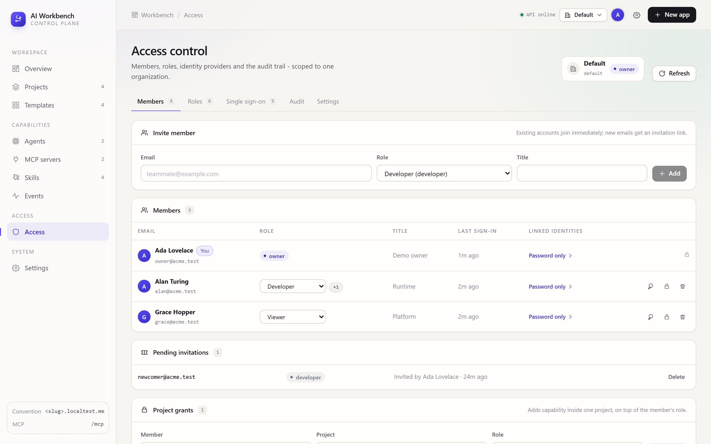
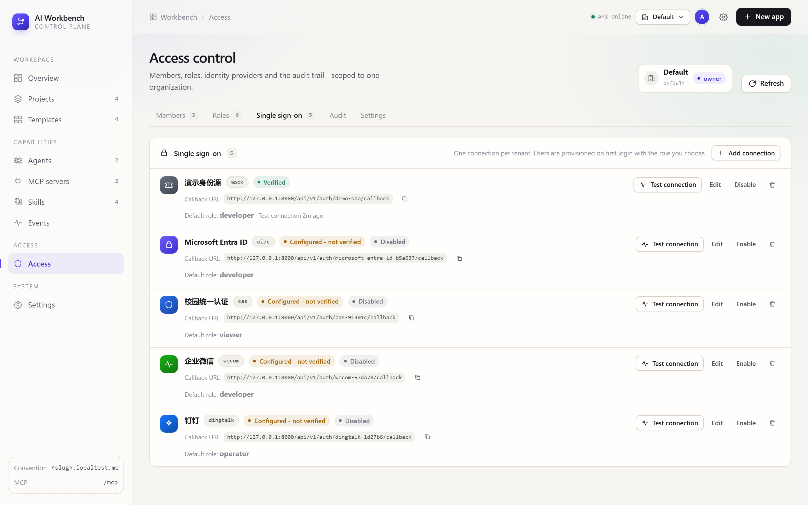
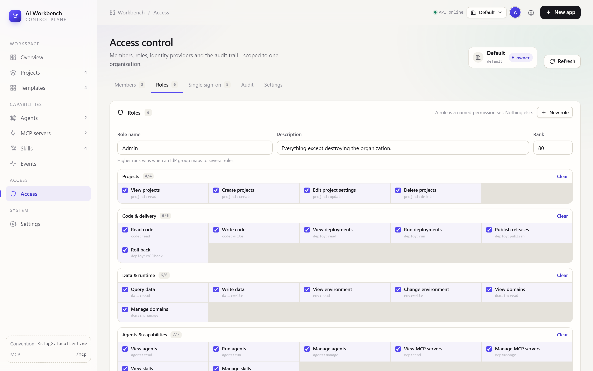
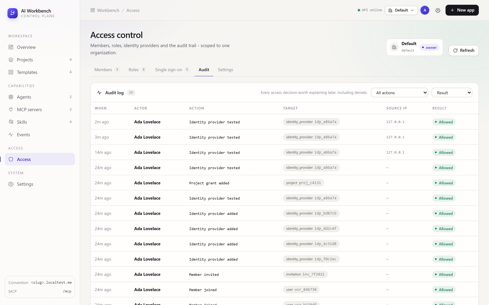

# Access control

Organizations, roles, members, sessions, audit — and one interface for five
identity providers (CAS, OAuth2, OIDC, WeCom, DingTalk).

Everything here is **off by default**: a local workbench should not ask for a
password to open a page. Flip one switch and the same middleware guards REST and
the mounted MCP app.

```bash
WB_AUTH_ENABLED=true
WB_FRONTEND_URL=http://localhost:3000    # where an SSO round trip lands
WB_PUBLIC_API_BASE=                       # empty -> derived from the request
```

---

## 1. The model

```
User ──< Membership >── Organization ──< Role
 ├──< Identity        (external subject from an IdP)
 ├──< RoleBinding     (extra grant, scoped to one project)
 ├──< Session         (opaque bearer token, hashed at rest)
 └──< AuditLog
```

| Entity | What it is | Why it exists |
| --- | --- | --- |
| **Organization** | the tenancy boundary | projects, members, roles, SSO connections and the audit trail all belong to one |
| **User** | a person, globally unique by email | one human can belong to several organizations |
| **Membership** | `(user, organization) → role_key` | joining a tenant is a row, not a flag |
| **Role** | a name plus a list of permission keys | see §2 — that is the entire definition |
| **RoleBinding** | `(user, project) → role_key ∪ permissions` | "viewer everywhere, admin on this one project" |
| **Identity** | `(provider, subject) → user` | the same person across five IdPs, one account |
| **Session** | opaque token, hashed, expiring | revocation is a row delete, not a JWT wait |
| **AuthRequest** | in-flight SSO state (one-shot) | state + PKCE verifier live server-side, never in a cookie |

### Two layers of authority

| Layer | Question it answers |
| --- | --- |
| Session → active organization | which tenant am I acting in *right now* |
| Membership → role | what may I do across this organization |
| RoleBinding → scope | what may I additionally do inside this one project |
| Route rule | what does this endpoint require |

They are recomputed on **every** request. There is no cached permission set to
invalidate, so removing someone from a role takes effect on their next click —
they do not have to log out and back in.

A session is pinned to one organization at a time. Switching sends
`POST /api/v1/auth/switch-org`, which rewrites the session row; every subsequent
request — REST, SSE and MCP alike — is then evaluated against that tenant. A
request may also name the tenant explicitly with the `x-org-id` header (accepts an
id or a slug), which is what service-to-service callers use.

---

## 2. The permission catalog

Thirty-five permissions, six groups, `domain:action`:

| Group | Permissions |
| --- | --- |
| `project` | `project:read` `project:create` `project:update` `project:delete` |
| `delivery` | `code:read` `code:write` `deploy:read` `deploy:run` `deploy:publish` `deploy:rollback` |
| `data` | `data:read` `data:write` `env:read` `env:write` `domain:read` `domain:manage` |
| `capability` | `agent:read` `agent:run` `agent:manage` `mcp:read` `mcp:manage` `skill:read` `skill:manage` |
| `access` | `member:read` `member:manage` `role:read` `role:manage` `sso:read` `sso:manage` `org:read` `org:update` `org:delete` |
| `platform` | `audit:read` `system:read` `system:manage` |

`GET /api/v1/permissions` returns this list verbatim — labels, Chinese labels,
descriptions and their group. **That is the only declaration in the codebase**:
the role editor renders checkboxes from it, `normalize()` rejects unknown keys, the
middleware matches routes against the same set, and the agent prompt is generated
from it. A typo in a role cannot become a silent no-op, and the UI cannot drift
from what the server enforces.

Wildcards are resolved, not stored per key:

- `*` — everything (only the `owner` role)
- `domain:*` — everything in one group, e.g. `deploy:*`

`expand()` resolves against the catalog, so a role saved under an older catalog
still logs in: unknown keys are dropped rather than raising.

---

## 3. Roles

A role is **a named permission set. Nothing else.** No inheritance graph, no
policy language, no conditions. "What may this role do" is a list you can read out
loud, which is the single most useful property a permission system can have for a
team of five to fifty.

Five builtins are seeded per organization:

| Role | Rank | Permissions | Intended for |
| --- | --- | --- | --- |
| `owner` | 100 | `*` (35) | one or two people; only role that can delete the organization |
| `admin` | 80 | 34 | everything except `org:delete` |
| `developer` | 60 | 27 | build projects: code, preview, deploy, publish, query data |
| `operator` | 40 | 19 | ship what developers built; no code, no access control |
| `viewer` | 10 | 15 | read-only, including logs and audit |

Builtins can be re-scoped (except `owner`) and renamed; only a **custom** role can
be deleted, and only while nobody holds it. `rank` is used for one thing: when an
IdP group maps onto several roles, the highest-ranked match wins.

The editor is at **Access → Roles**. Every change is audited
(`role.created`, `role.updated`, `role.deleted`).

---

## 4. Organizations

The organizations you belong to appear in the top-bar switcher. Creating one makes
you its owner; projects created while it is active are provisioned inside it.

| Operation | Endpoint | Permission |
| --- | --- | --- |
| list / create | `GET,POST /api/v1/orgs` | — / — |
| read / update | `GET,PATCH /api/v1/orgs/{id}` | `org:read` / `org:update` |
| delete | `DELETE /api/v1/orgs/{id}?purge_projects=` | `org:delete` |
| members | `GET,POST /api/v1/orgs/{id}/members` | `member:read` / `member:manage` |
| roles | `GET,POST /api/v1/orgs/{id}/roles` | `role:read` / `role:manage` |
| SSO | `GET,POST /api/v1/orgs/{id}/sso` | `sso:read` / `sso:manage` |
| audit | `GET /api/v1/orgs/{id}/audit` | `audit:read` |
| grants | `GET,POST /api/v1/orgs/{id}/bindings` | `member:read` / `member:manage` |

Two rules that are easy to get wrong, and are therefore enforced in code, not
conventions:

1. **Membership is the boundary for objects too.** `can_access(principal, owner_id,
   org_id)` checks the organization first; being admin of *your* org never lets you
   read *my* project by id.
2. **Every org handler re-checks the org in the URL.** The middleware answers "does
   this caller hold X in the org their session points at"; each handler additionally
   calls `_require(session, principal, org_id_from_url, permission)`. Changing a path
   segment cannot pivot you into another tenant — it 404s, deliberately, so the API
   does not confirm that a foreign organization exists.

### Invitations

`POST /orgs/{id}/invitations` creates a one-shot token (7 days by default) and
returns `accept_url` = `<WB_FRONTEND_URL>/invite#token=…`. The token is delivered in
the **fragment**, which browsers never send to a server, so it stays out of access
logs. `POST /api/v1/invitations/accept` redeems it for a membership. Adding an
existing account by email skips the invitation and joins immediately.

### Project-scoped grants

`POST /orgs/{id}/bindings` with `{user_id, role_key?, permissions[], scope_type:"project",
scope_id}`. The project must belong to the same organization (404 otherwise). A grant
only ever *adds* capability, and only inside the one scope it names.

---

## 5. Sessions and credentials

| Property | Value |
| --- | --- |
| Token format | `wbs_` + 43 base64url chars from 32 random bytes |
| Stored as | SHA-256 hash — a database dump does not hand out sessions |
| Lifetime | `WB_AUTH_SESSION_HOURS` (12h default), sliding activity marker |
| Transport | `Authorization: Bearer …`; SSE falls back to `?token=` |
| Passwords | scrypt (N=2¹⁴, r=8, p=1), constant-time compare — stdlib only, no compiler needed |
| Revocation | row delete / `revoked_at`; immediate |

`DELETE /api/v1/auth/sessions/{id}` revokes one session, `POST /api/v1/auth/password`
changes the password and revokes **all other** sessions. `POST
/api/v1/orgs/{id}/members/{membership_id}/reset-password` issues a temporary
password for a member (audited, shown once).

There are no cookies. There is no CSRF surface. The browser keeps the token in
`localStorage` and any `401` sends the app to `/login` with `?next=` — one redirect,
not N broken panels.

### Bootstrap tokens

`WB_AUTH_TOKENS="tok1:alice:admin,tok2:bob:viewer"` still works, for CI and for
scripted setup. Such a principal holds the mapped builtin role's permissions and is
treated as a member of the default organization; it carries no membership row, but
`_require` lets it through with its own permission set.

**Bootstrapping an SSO-only install.** If the only way in is SSO, nobody can name
the first owner — the first login would join as `developer` and the organization
would have no administrator. The escape hatch is one env var:

```bash
WB_AUTH_BOOTSTRAP_TOKEN=workbench-dev-token   # also the default when WB_AUTH_TOKENS is empty
```

1. Sign in at `/login` → "Use a token instead" with that value.
2. **Access → Members** → add the human's email as `owner` (or change their role).
3. Unset the variable and restart.

---

## 6. Single sign-on

Five providers, one interface — the same SPI shape as storage/database/domain/deploy:

```
authorize_url(ctx) → browser leaves → IdP → callback(code, state)
   → exchange(code, ctx) → ExternalProfile(subject, email, name, avatar, groups)
   → provision() → link or create the user → membership → session
```

```python
class AuthProvider:
    def required(self) -> list[str]: ...        # fields that must be present
    def required_secret(self) -> list[str]: ... # secrets that must be present
    def ready(self) -> bool: ...               # configured enough to try
    def authorize_url(self, ctx: AuthorizeContext) -> str: ...
    def exchange(self, code: str, ctx: AuthorizeContext) -> ExternalProfile: ...
    def probe(self) -> dict: ...               # "Test connection" in the UI
```

`SCHEMA` in `app/providers/auth/__init__.py` declares each kind's fields, secrets,
labels, blurbs and docs link. `GET /orgs/{id}/sso/schema` returns it, and the access
page renders the form from it — so adding a sixth kind means adding a class and a
schema entry, **not** another hand-written React form.

### The status lifecycle

```
unconfigured ──(fill the required fields)──▶ unchecked ──(Test connection ok)──▶ ready
      ▲                                          │                                  │
      └──────────── required field removed ──────┘◀───────────── probe failed ──────┘
```

`unchecked` is the honest state for "saved but never verified"; only a real probe
may claim `ready`. The console shows `Missing: …` with the exact field keys, which
is also what the API returns.

### Provisioning

On a successful callback:

1. `Identity(provider_key, subject)` → existing user, else match by email, else
   create (`auto_create_users`, otherwise 403: "no auto-creation, ask for an invite").
2. `allowed_domains` is checked first — an empty list means no restriction.
3. `auto_join` adds the membership in the provider's organization; `default_role_key`
   is the role. **An existing member is never silently demoted** by logging in.
4. `role_map` (JSON, e.g. `{"wb-admins": "admin"}`) maps IdP groups onto roles; the
   highest-ranked match wins, otherwise `default_role_key`.

All of it is audited (`auth.sso_start`, `auth.sso_failed`, `member.joined`).

### Callback URLs

Register this exact URL in the provider console — it is shown next to each
connection in the UI, with a copy button:

```
{WB_PUBLIC_API_BASE or request origin}/api/v1/auth/{provider_key}/callback
```

`provider_key` is the login path segment (`microsoft-entra-id`, `cas-91301c`, …).
It is globally unique across the install; when two organizations add a connection
of the same kind and no key is given, a suffix is appended instead of failing.

---

### 6.1 CAS

For universities and intranets. `CAS 2.0 / 3.0`, ticket validation over XML.

| Field | Meaning |
| --- | --- |
| `base_url` *(required)* | e.g. `https://cas.example.edu.cn/cas` |
| `version` | `3` (default) or `2` |
| `email_attr` | attribute holding the email, default `mail` |
| `name_attr` | attribute holding the display name, default `displayName` |

CAS is **not** OAuth — there is no token endpoint, no PKCE, and the "code" is a
service ticket. Consequences the implementation handles explicitly:

- `state` travels inside the `service` URL (`?state=…`), because CAS has nowhere
  else to put it.
- `GET {base_url}/serviceValidate` (or `p3/serviceValidate`) returns XML, parsed with
  `ElementTree`; attribute lookup is case-insensitive and accepts both the 2.0 and
  3.0 shapes.
- A ticket arriving in a *user attribute* is a proxy ticket — rejected, not trusted.
- The subject falls back to the returned `user`; if no email attribute exists, an
  address is synthesised as `{user}@{email_domain or sso.local}`.

### 6.2 OAuth 2.0 (generic)

For anything that speaks the authorization-code flow and returns JSON userinfo.

| Field | Meaning |
| --- | --- |
| `authorize_url` *(required)* | |
| `token_url` *(required)* | |
| `userinfo_url` | skipped when absent — claims then come from the token response |
| `client_id` *(required)* | |
| `client_secret` *(secret, required)* | |
| `scope` | default `openid profile email` |
| `token_auth` | `post` (default) or `basic` — how the client authenticates at the token endpoint |
| `mappings` | JSON dotted paths: `{"subject":"sub","email":"email","name":"name","avatar":"picture"}` |

PKCE S256 is sent when the IdP advertises support; if it does not, the challenge is
still generated but never required — the state parameter is always enforced.

### 6.3 OpenID Connect

For Entra ID, Keycloak, Auth0, Okta, Google, Authentik, Zitadel…

| Field | Meaning |
| --- | --- |
| `issuer` *(required)* | reads `<issuer>/.well-known/openid-configuration` (cached 1h) |
| `client_id` *(required)* | |
| `client_secret` *(secret, required)* | |
| `scope` | default `openid profile email` |
| `group_claim` | which claim carries groups, default `groups` |

The `id_token` is **verified**, not decoded: signature against the issuer's JWKS,
`alg=none` rejected, `iss` / `aud` / `exp` / `nonce` checked. Userinfo is fetched as
a bonus, never as the source of truth — trusting userinfo alone is the classic SSO
weakness, because the endpoint is outside the signed assertion.

Examples of `issuer`:

```
https://login.microsoftonline.com/<tenant-id>/v2.0
https://keycloak.example.com/realms/<realm>
https://accounts.google.com
```

### 6.4 WeCom (企业微信)

| Field | Meaning |
| --- | --- |
| `corp_id` *(required)* | 企业 CorpID |
| `corp_secret` *(secret, required)* | 应用 Secret |
| `agent_id` | 应用 AgentId (needed for the in-client entry point) |
| `mode` | `qr` = scan to log in (default), `oauth` = in-client web authorization |

Two different hosts are involved, and the mode picks the right one:
`login.work.weixin.qq.com/wwlogin/sso/login` for the QR flow,
`open.weixin.qq.com/connect/oauth2/authorize` inside the WeCom client. The app
`access_token` is cached per process (it is rate limited); the profile comes from
`auth/getuserinfo` → `user/get`, and an account that is not a member of the corp is
rejected rather than provisioned.

### 6.5 DingTalk (钉钉)

| Field | Meaning |
| --- | --- |
| `client_id` *(required)* | AppKey |
| `client_secret` *(secret, required)* | AppSecret |
| `scope` | default `openid` |

`POST https://api.dingtalk.com/v1.0/oauth2/userAccessToken` returns a user token;
the profile is then read from `contact/users/me` with the
`x-acs-dingtalk-access-token` header. The subject is `unionId`, which is stable
across the org's apps — `openId` is not.

### 6.6 The demo provider

The workbench serves its own OIDC-shaped identity provider at
`/api/v1/auth/mock/authorize` and seeds one connection (`demo-sso`, kind `mock`).
It walks the **real** path — state → code → token → profile → provision — so the
whole login chain is testable offline and in CI, and it is the same code path a
real tenant uses. The consent page supports `?auto=1&email=…&groups=…` for scripts.

`backend/tools/auth_smoke.py` uses it for 41 end-to-end assertions.

---

## 7. Agents and MCP

The agent runtime and the MCP server are *not* a back door. Both go through
`system_tools`, and every tool that changes something is wrapped with the calling
principal's permissions:

```python
_guard("project:create", create_project)   # agent calling it as a viewer → 403
```

Two tools exist so an agent can reason about the boundary instead of guessing:
`describe_access` (who am I, which org, which permissions) and `check_permission`
(would this specific action be allowed). The prompt tells the model that a `403` is
a boundary, not a bug, and that SSO secrets are unreachable through tools. The audit
log records the refusal either way.

---

## 8. Audit

Append-only, scoped per organization, readable at `GET /orgs/{id}/audit` with
`audit:read`. Two rules make it useful rather than decorative:

- **Denials are recorded too** — `access.denied` is written *before* the 403 leaves
  the middleware. "Who tried and failed" is the question you ask during an incident.
- **A failed audit write never breaks the request.** Losing a row must not fail a
  deployment.

| Action | When |
| --- | --- |
| `auth.login` / `auth.login_failed` / `auth.logout` | password sign-in |
| `auth.sso_start` / `auth.sso_failed` | SSO round trips |
| `auth.session_revoked` | explicit revocation |
| `member.invited` / `member.joined` / `member.role_changed` / `member.removed` | membership |
| `role.created` / `role.updated` / `role.deleted` | permission sets |
| `binding.created` / `binding.removed` | project grants |
| `sso.created` / `sso.updated` / `sso.deleted` / `sso.probed` | identity providers |
| `org.created` / `org.updated` / `org.deleted` | tenancy |
| `access.denied` | any refused request, with the required permission |

Each row carries actor, action, resource, result, source IP (from
`x-forwarded-for` when present) and a detail object.

---

## 9. Operating notes

| Variable | Default | Meaning |
| --- | --- | --- |
| `WB_AUTH_ENABLED` | `false` | false → anonymous owner of the default org (local mode) |
| `WB_AUTH_TOKENS` | — | extra operator tokens, `token:name:role` — mapped onto a builtin role, no membership row needed |
| `WB_AUTH_BOOTSTRAP_TOKEN` | `workbench-dev-token` | operator token for bootstrapping |
| `WB_FRONTEND_URL` | `http://localhost:3000` | where the SSO callback redirects |
| `WB_PUBLIC_API_BASE` | request origin | used to build callback URLs |
| `WB_AUTH_SESSION_HOURS` | `12` | session lifetime |
| `WB_AUTH_ALLOW_SIGNUP` | `true` | local email+password sign-up |
| `WB_AUTH_DEFAULT_ORG` | `default` | owner of pre-organization projects |
| `WB_AUTH_STATE_TTL` | `10` | minutes an SSO state stays valid |

**Behind a proxy**: set `WB_PUBLIC_API_BASE` to the public https origin, so callback
URLs match what you registered. `X-Forwarded-For` is honoured for the audit trail.

**Rotating a secret**: edit the connection, leave the secret field empty — empty
means "keep the stored value", never "clear it".

**Turning auth off again** is safe: rows stay, projects keep their `org_id`, and the
anonymous principal is an owner of the default organization.

---

## 10. Trying it

```bash
# backend with auth on, demo data seeded
cd backend
WB_AUTH_ENABLED=true uv run uvicorn app.main:app --port 8000

# 41 assertions: unauthenticated 401, SSO JIT provisioning, cross-org isolation,
# invite + accept, viewer 403 on role creation, project-scoped grant, all five
# IdP kinds creatable, wildcard expansion, logout invalidating the token
uv run python tools/auth_smoke.py

# a realistic organization for the console: 3 members, a custom role, a pending
# invitation, a project grant and five SSO connections. Targets the default org if
# you already belong to it, otherwise the one this script's account creates
uv run python tools/access_demo.py

# then sign in as owner@acme.test / workbench-demo-1 and open /access
```








